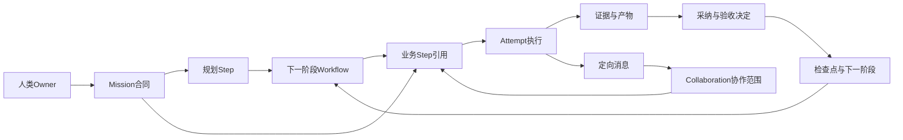

# 001 Domain

本章定义对象与关系，承接[设计原则](000-philosophy.md)。独立运行时管理任务事实，harness执行推理；群聊和面板呈现同一批记录。

## 主流程

人确认Mission合同后，程序按合同建立默认Collaboration和规划Step；Lead执行该Step提出下一阶段Workflow。Step先属于Mission，Workflow只编排和引用Step。运行时检查授权与依赖后创建Attempt。Agent也可直接请求无Workflow的同伴Step，或发布证据供相关成员读取。产物经验收后进入检查点，决定继续、调整或结束。

## 对象

| 对象 | 主要内容 | 必须保持的规则 |
|---|---|---|
| Mission | 目标原文、revision、成功标准、禁止项、授权人、期限、总预算 | 任务身份独立于任何会话；有效合同版本唯一 |
| Collaboration | 参与者、共享范围、交付Owner、互动规则、额度、截止与收敛条件 | 可容纳多个平级Step；有额度不等于获得工具权限 |
| Workflow revision | 下一阶段控制图、Step引用、依赖、循环上限、停止条件 | 版本不可覆盖；不是Step或授权的身份来源 |
| Step | Mission内稳定step_id、step_revision、kind、工作合同、依赖、状态 | 规划/路由/业务/审查均可独立存在；重试或换计划不换逻辑身份 |
| Attempt | Step及合同版本、input_set_id、设备、harness/session/turn、配置、回执、费用 | 一次执行尝试；跨版本与会话仍受旧unknown约束 |
| Agent identity | 逻辑地址、角色、能力、当前执行绑定 | 成员存在不等于有活跃模型；地址不由消息正文伪造 |
| Message | 作者、收件人、正文或引用、回复关系、执行归属、唤醒政策 | 重试使用同一ID；可见、送达、回答、验收各不相同 |
| Decision | 决策者、被决策对象及版本、依据、条件、接受/拒绝 | 接受与其对象版本绑定；保留异议 |
| Context item / Artifact | 原文或产物、版本/hash、来源、适用范围、支持与反证 | 引用可核对，摘要可重建；本机路径不是唯一身份 |
| Checkpoint | 当前合同、已验收结果、未完工作、费用、消息游标、下一预期 | 是恢复入口，不覆盖原始事实 |

Subscription、执行预约、费用事件、输入集合和定时器是上述对象的关联记录，不另设管理Agent。input_set保存该Attempt的待提交payload、消息/控制/证据版本、hash及稳定关联ID；后到的原生回执在关联记录追加，不改快照。它不是又一个共享知识库。渠道Source负责输入身份与外部消息定位，不把飞书线程当成Mission本身。

Workflow中的step_key、item_key、iteration是编排位置，映射到稳定step_id及step_revision。变更工作合同增加step_revision；替换Step必须声明supersedes_step_id，沿替换链核对旧执行。运行时按既有工作与请求ID分配身份，不让Lead任意换ID解除阻塞；无法判定是否替代未知工作时先阻塞澄清。全新ID的语义重复仍不能保证自动识别。

## 协作关系

| 关系 | 行为 | 首版范围 |
|---|---|---|
| 委派 | 请求者给工作合同，执行者交付 | 支持显式父子依赖 |
| 对等协商／共同审查 | 双方独立取证、质疑、反提案、拒绝或补证 | 有界双Agent，费用从共同协作账户记入 |
| 交接 | 原Owner提出，接任者确认范围与未决项 | 完整首版按owner revision原子替换；内核切片固定Owner |
| 共享证据协作 | 发布记录，订阅相关变化，分别判断如何使用 | 内核用显式引用与定向通知；完整首版小范围订阅，不全员唤醒 |
| 竞争选择 | 独立候选按共同标准比较 | 专用模板延期 |

Claude六种控制模式为classify-and-act、fan-out-and-synthesize、adversarial verification、generate-and-filter、tournament、loop-until-done。它们可以承载不同协作关系；对等协作不能被全部改写成委派树。[来源与证据边界](MULTI-AGENT-SOURCE-REVIEW.md)

## 身份与所有权

Mission Owner指具名人类授权人。Lead是执行侧规划角色；Collaboration/产物Owner可以是被授权的Agent，负责交付和保留争议，不得自行改目标。Reviewer是一次执行角色，不是常驻服务。

逻辑Agent可映射到不同设备和session。创建来源的父子树只管理生命周期，不自动决定对等消息的权限、费用或required_for依赖。一个session只允许一个活跃受控turn。

context-only订阅表示可以获得相关上下文；请求所有权表示负责响应；执行授权表示可以采取哪些行动。这三者分别记录。相似话题不能自动合并任务。范围外请求沿原request ID退回，保留原因。

## 三层共享上下文

1. 控制事实：完整目标、有效授权、禁止项、暂停与合同版本。模型摘要不能覆盖。
2. 证据与判断：来源、实验结果、工作结论、异议和未知项，均带版本与适用范围。
3. 执行上下文包：当前Step必需内容与其他记录的索引，绑定输入游标。

知识状态为proposed、accepted_for_use、conditional、contested、rejected、stale、superseded。不可读是来源的unavailable状态，与“结论被否决”不同。已接受是当前范围内的工作依据，不是真理认证。谁能接受见[授权](002-authorization.md)。

Step verified保留历史验收事实；可否作为当前依赖由Decision所绑定版本、有效状态与适用条件决定。来源过期不删除历史验收，也不继续无条件满足后继；规则见[Execution](003-execution.md)。

wait_for等待回应；required_for约束有效结果，带dispatch或acceptance门槛。未完成的上游先以Step/版本引用，消费时再绑定Decision。这样同伴拒绝也能唤醒协调续跑，而不会因必须先验收同伴结果陷入死锁。

依赖证据区分运行时注入、适配器观测和Agent自报；无法观察内部工具时标opaque。只有实际强制关键输入走受控入口，才能在该范围标enforced。未命中read_set不能证明结论未过期。

## 有意不引入的概念

不以Kanban列作为执行权威，不以群聊机器人数量定义Agent数量，不以同一个会话持续在线定义长程任务。共享黑板使用既有Message和Context item，不另建第二个知识权威；恢复卡是视图，不是新的事实库。

下一篇：[002 Authorization](002-authorization.md)。
