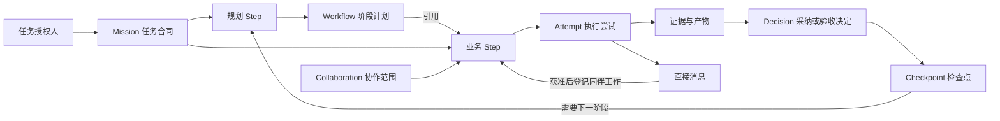

# 001 Domain：从一个任务理解系统

独立协作运行时保存任务事实，Hermes、Codex 等 harness 负责模型推理和工具执行。人的目标可以持续一个月，而执行它的会话可以多次结束、压缩或重建。本章先用一个例子说明对象之间的关系，再给出其余章节共用的术语。

## 贯穿示例：完成一份市场研究

人提出一个月目标：“比较三个市场的需求规模，交付有来源、有口径说明的报告。”他同时约定预算、截止日期、可读取的数据以及禁止动作。系统把这份约定保存为任务合同。

Lead 先提出一个短阶段：由 A 整理主要数据，遇到口径分歧时请 B 独立核对。A 发现两份资料的统计日期不同，直接 @B 请求检查。B 可以给结果，也可以拒绝缺少来源的请求；A 收到回复后继续分析。双方的消息在群聊中保留作者与回复关系，交付负责人按合同接受报告。

这里有两条不同的关系：工作流决定已接受的计划怎样推进；Agent 的直接请求可以产生新的同伴工作。两者最终都进入同一套授权、执行和费用规则，详见 [003 执行流程](003-execution.md#flow)。

## 两个交付范围

**内核切片**是单机闭环：一个任务、一个协作范围、两个固定成员槽位，接入 Hermes 和 Codex。它验证直接请求与回复、有界阶段计划、证据采纳、人工控制、费用记录和重启对账。同伴按需运行，两个槽位不表示两个模型常驻。

**完整首版**在内核切片上增加真实飞书入口、两设备执行、工作交接、小范围订阅和按需模型路由。模型 Router、远程节点代理和完整交接不属于内核切片的前置工程。30 天可靠运行还要单独取得长程验收证据。

以上范围承接 [000 设计原则](000-philosophy.md)。后文分别用“内核切片”和“完整首版”指代这两个交付范围。

## 核心对象与术语

中文名称用于解释，代码名用于协议和记录。一个概念保持一个主称谓；角色是职责，不要求每种职责都有一个常驻 Agent。

| 名称 | 含义 |
|---|---|
| 任务 `Mission` | 人授权的长期目标及合同；包含目标原文、成功标准、禁止项、权限、预算、期限和有效版本 |
| 协作范围 `Collaboration` | 某项交付涉及的成员、共享范围、费用额度、收敛条件与负责人；可以包含平级工作 |
| 阶段计划 `Workflow` | Lead 提出的有限执行图，引用已有或新登记的 Step；每次修改保留一个版本 |
| 工作项 `Step` | 有稳定身份的逻辑工作，如规划、分析、审查或处理同伴请求；可以没有 Workflow |
| 执行尝试 `Attempt` | 为完成某个 Step 版本而进行的一次受控执行；保存输入、原生回执、产物和费用关联 |
| 决定 `Decision` | 谁依据什么证据，对哪个对象版本作出何种决定，以及决定的适用条件 |
| 消息 `Message` | 有认证作者、收件人、正文、回复关系和工作归属的信息；消息本身不授予权限 |
| 证据项 `Context item` | 带来源、版本、适用范围、支持与反证的记录 |
| 产物 `Artifact` | 可按稳定 ID 和内容 hash 找回的原始资料或交付内容；本机路径只是位置 |
| 检查点 `Checkpoint` | 当前目标、证据、未完工作、费用和下一步的恢复入口；引用原始事实 |
| 执行绑定 `binding` | 逻辑成员与设备、harness、会话及配置之间的关联 |
| 输入集合 `input_set` | 某次 Attempt 准备提交的完整输入快照；后续回执另行关联，不修改快照 |
| 回合 `turn` | harness 接收输入后到报告终态的一段执行；内部可能包含多次模型请求和工具续跑 |
| 事件日志 `journal` | 已接受的控制变化、执行意图及观测事实；用于审计和恢复 |
| 收件箱 / 待发箱 `inbox / outbox` | 前者保存收到的消息与事件，后者保存待投递的消息或执行意图；重启后按记录继续处理 |
| 费用账本 | Mission 的已知消耗、预算预约与未对账费用；与事件日志同属一个权威存储 |
| 执行槽位 / 预算预约 | 前者限制同时运行的工作，后者占住预计费用；释放条件分别判断 |
| 控制服务 / 控制实例 | 前者是运行时职责，后者是正在运行的一个进程实例 |
| 执行节点 / 节点代理 | 前者是执行所在设备或环境，后者是完整首版连接远程 harness 的进程 |

## 谁负责什么

**任务授权人（Mission Owner）**是具名的人类，决定目标、权限、总预算及其变更。**交付负责人（Delivery Owner）**按合同对成果负责，可以是人，也可以是获授权的 Agent。**请求负责人（Request Owner）**负责响应某条工作请求，退回请求不等于改变任务授权。

Lead 是规划角色，Worker 是执行角色，Reviewer 是一次独立审查角色，Router 只在归属不明时给路由建议。Lead 可以兼任交付负责人。合同要求独立审查时，由非作者 Reviewer 提供意见；要求独立验收时，最终接受者也必须与作者不同。具体条件见 [002 授权分类](002-authorization.md#classification)。后文按具体职责使用这三个中文名称。

逻辑 Agent 的地址独立于会话和设备。同一个成员可以更换会话，两个成员也可能使用同一类 harness。原生创建关系只说明生命周期来源，不能据此推导消息权限、工作依赖或费用归属。

## 协作关系与工作流模式

| 协作关系 | 系统中的表达 | 交付范围 |
|---|---|---|
| 委派 | 请求者给出合同，执行者交付；需要时登记父子依赖 | 内核切片支持 |
| 对等协商与共同审查 | 双方独立取证、质疑、反提案、拒绝或补证；使用平级 Step | 内核切片支持有界双成员协作 |
| 工作交接 | 原负责人提出交接，接任者确认范围、未决工作和责任 | 完整首版按负责人版本原子变更；内核切片固定负责人 |
| 共享证据协作 | 发布带版本的证据，其他成员按权限读取或订阅变化 | 内核切片使用显式引用和定向通知；完整首版增加小范围订阅 |
| 竞争选择 | 多个独立候选按共同标准比较 | 专用模板延期 |

Claude Code Dynamic Workflows 文章中的六种模式为 classify-and-act、fan-out-and-synthesize、adversarial verification、generate-and-filter、tournament、loop-until-done。它们描述控制流，不能替代上表中的协作关系。文章与本地源码快照的证据等级不同，来源见 [Claude Code、DSH 与 Codex 对照](MULTI-AGENT-SOURCE-REVIEW.md)。

## 等回复与需要有效结果，是两件事

在市场研究示例中，A 请 B 检查统计口径。A 需要知道 B 的答复，但最终报告是否必须采用 B 的有效结论，要由工作合同另行规定。

- `wait_for` 记录等待的回应或事件。有效且关联正确的结果、拒绝或补证请求都能满足这次等待。系统保存事件后，仍需等当前回合结束并重新准入，才让 A 继续。
- `required_for` 记录工作依赖。`gate=dispatch` 表示业务执行前必须具备有效结果；`gate=acceptance` 表示可以先分析或讨论，但验收时必须满足该门槛。

因此，B 拒绝请求后，A 仍可处理拒绝或重新取证，而不会因为缺少 B 的有效结论而无法继续讨论。迟到、越权、版本不适用或发给终态工作的回复只留档，不自动启动执行。

工作依赖的唯一权威是 **Step revision 下的依赖记录**。Workflow 引用它们；Message 可以提出依赖请求，只有通过授权检查才形成记录。规划时先引用上游 Step 及版本，真正派发或验收时再绑定适用的 Decision。门槛变更规则见 [002 依赖变更](002-authorization.md#dependency-changes)。

## 身份、版本与共享上下文

`step_id` 由运行时分配，跨计划版本保持稳定。工作合同改变时增加 `step_revision`；替换工作记录 `supersedes_step_id`。计划中的 `step_key`、`item_key`、`iteration` 只是位置，不用于清除旧执行的阻塞。无法确定新请求是否替代未知工作时，先澄清归属。

共享上下文分为三层：控制事实保存完整目标、授权和暂停；证据层保存来源、判断与反证；执行上下文包只提供当前工作所需内容和索引。群聊、摘要和恢复卡展示这些记录，不另建知识权威。

知识可处于 `proposed`、`accepted_for_use`、`conditional`、`contested`、`rejected`、`stale` 或 `superseded`。来源读取失败用 `unavailable` 表示。知识被采纳只是范围内可用的工作依据；Step 的 `verified` 则是一次历史交付验收，两者不能混用。

## 阅读后续章节时会遇到的词

| 术语 | 在这套文档中的意思 |
|---|---|
| `read_set` | 某个结论依赖的已记录读取或输入集合；不保证覆盖黑盒 Agent 的所有读取 |
| `injected / observed / reported / opaque` | 分别表示运行时注入、适配器观察、Agent 自报、内部不可见；`enforced` 另表示指定范围确实强制经过受控入口 |
| `coverage` | 用量或观测覆盖了哪些调用、哪些分项，哪里仍有缺口 |
| `epoch` | 区分计数器或回放游标不同代际的标识；重置后不能直接沿用旧差额 |
| `handback / context-only` | 退回请求及原因 / 只接收上下文、不自动承担请求责任 |
| `busy steer` | harness 正在执行时，把新增输入送入原回合；内核切片采用运行时排队 |
| 强单 Agent / 有界协商 | 同配置、同证据且允许自审的单执行者基线 / 有成员数、轮数、期限及预算上限的同伴协作 |
| `effects / permit / Host` | 来源实现中的外部动作意图、执行许可、宿主扩展；不是本项目默认已有的公开接口 |
| DSH / V3.1、V3.2 | DSH Superagent 原型 / 本项目此前设计版本；来源与历史见研究入口 |
| G0–G2 / G-A～G-E | 前者是早期研究批次；后者是当前发布验收分类，定义见 [006](006-deployment.md#gates) |

下一篇：[002 Authorization：谁能作出决定](002-authorization.md)。
