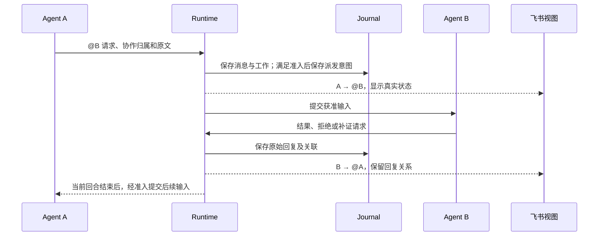

# 003 Execution：工作怎样推进和恢复

运行时把“想做什么”变成有归属、可对账的执行。以市场研究为例，A 请求 B 检查口径后，可以结束当前回合等待；B 的回复被保存后，A 再申请下一次执行。进程是否结束、工作是否完成、报告是否可信和费用是否结清，是四个分别记录的问题。

本章是执行状态、消息消费、费用和恢复的规则归属。授权规则见 [002](002-authorization.md)。以下合同用于指导实现，现有局部探针并不代表运行时已经建成。

## 从长期目标推进到下一段工作

任务授权完成后，程序先登记 Lead 的规划 Step。Lead 读取当前合同、检查点、有效证据和剩余额度，提出下一阶段。阶段应短到能够交付可观察的产物，并明确何时完成、何时补证、何时停止。

内核切片接受声明式阶段图，只解释四类动作：调用获准成员、等待已登记事件、结束阶段、请求人决定。分支条件取自结构化结果，例如“完成”“缺证”“阻塞”或“拒绝”；分支只能指向图内有限动作，或结束本阶段后返回 Lead 重规划。

阶段提案包含合同与计划基线版本、Step 引用或新工作合同、成员、证据与验收要求、依赖、额度、往返上限、截止及退出条件。程序既检查图结构，也按 [授权分类](002-authorization.md#classification)检查权限与变更范围。无界循环、等待环、悬空引用、越权动作和削弱门槛的未批准变更都会被拒绝。

Lead 在预授权范围内接受阶段计划，超出范围则提交人类提案。格式修正也属于计费执行，并受合同限制。现有 Agent 具备提出计划和执行提示的基础，但阶段校验、统一准入和完整闭环仍待实现；任意生成代码和 Claude Code 私有工作流兼容不属于当前实现范围。

## 工作身份先于计划存在

Step 可以属于某个 Workflow，也可以独立处理同伴请求。规划、路由、审查和业务执行使用同一套 Step/Attempt 规则。运行时分配 `step_id`，工作合同变化增加 `step_revision`，真正替换工作时记录 `supersedes_step_id`。

状态按 Step 版本保存，当前视图指向有效版本，并记录负责推进该版本的当前 Attempt。新版本登记后，仍须检查整个逻辑工作及替代链上的执行。旧版本回执只更新它原来绑定的记录，不能直接推进新版本。需要承接旧产物时，由合同指定的接受者明确判断其适用性，保存引用原产物的新决定；新输入仍按新修订建立。

Workflow 中的步骤位置不改变工作身份。新循环可以登记新工作，但要保存来源并遵守阶段上限；模型换一个 ID 不能自动解除旧执行阻塞。系统无法可靠判断语义重复时，请人澄清，不声称内容 hash 能识别所有重复工作。

## Step 状态与转换

Step 状态描述业务进展。暂停、取消请求和证据有效性另有标志：`paused` 关闭准入和自动验收，`cancel_requested` 表示正在请求停止，`requires_revalidation` 表示当前输入或输出需要复核。它们不会抹掉 Attempt 的实际执行状态。

| 状态 | 含义 |
|---|---|
| `planned` | 工作合同已登记，等待派发依赖具备 |
| `ready` | 当前派发依赖满足，等待额度、空闲槽位和控制版本等准入检查 |
| `running` | 已登记派发中的 Attempt，或有证据表明 Attempt 正在执行 |
| `waiting_event` | 当前 Attempt 已结束，等待指定回应或事件 |
| `waiting_human` | 当前 Attempt 已结束，有具名的人类决策者和明确待决提案 |
| `result_pending` | 结果已持久化，等待合同规定的验收或复核 |
| `blocked` | 出现需处理的缺口，保存原因和解除条件，如执行未知、证据失效或权限不足 |
| `verified` | 该版本的交付已验收；历史事实保留 |
| `failed` | 工作按合同停止为失败；记录原因和已发生的执行 |
| `cancelled` | 业务已撤销或明确放弃；可能仍有待对账的旧执行与费用 |

下表定义允许的业务转换。所有转换都检查对象版本并写事件日志；未列出的转换拒绝处理。等待或终态文本只有与 harness 的执行证据相符时才生效。只有负责推进该版本的当前 Attempt，其回执才可能触发这些业务转换；旧 Attempt 的处置规则见下文。

| 当前状态 | 事件和条件 | 转到 |
|---|---|---|
| `planned` | 派发依赖已满足 / 发现异常缺口 | `ready` / `blocked` |
| `ready` | 准入事务登记 Attempt 与派发意图 / 准入条件失效 | `running` / `blocked` |
| `running` | Attempt 完成且有合格产物 | `result_pending` |
| `running` | Attempt 已结束，Worker 等待有效事件或人工提案 | `waiting_event` / `waiting_human` |
| `running` | Attempt 已结束，所等回复已经到达且满足继续条件 | `ready`；条件不满足则 `blocked` |
| `running` | 失去执行确定性，或已停但有权限、证据等缺口 | `blocked`；未知执行仍占住相应约束 |
| `running` | 工作执行失败 / 撤销请求得到停止确认 | `failed` / `cancelled` |
| `running` | 因暂停而取消 Attempt，停止已确认且业务未撤销 | `blocked`，原因是暂停待恢复 |
| `waiting_event` | 有效回应到达且继续条件满足 / 超时需人工选择 / 等待失去有效性 | `ready` / `waiting_human` / `blocked` |
| `waiting_human` | 有权的人作出有效决定且继续条件满足 / 决定要求补齐条件 | `ready` / `blocked` |
| `result_pending` | 验收通过 / 要求合同内补证 / 条件失效 / 确认不可交付 | `verified` / `ready` / `blocked` / `failed` |
| `blocked` | 所有缺口解除，确需新增执行，等待条件和派发依赖均满足 | `ready` |
| `blocked` | 复核确认已有产物仍适用，且原 Attempt 已终态 | `result_pending`，继续验收已有产物 |
| `blocked` | 缺口解除、原 Attempt 已终态，但原等待仍未满足 | `waiting_event` / `waiting_human`，恢复原等待记录 |
| `blocked` | 对账证明原 Attempt 仍在执行 | `running`，沿用原 Attempt，不创建新执行 |
| `blocked` | 找回原 Attempt 的终态与结果或等待请求 | 按结果转 `result_pending`、`waiting_event`、`waiting_human`、`failed` 或 `cancelled` |
| `failed` / `cancelled` | 有权者显式批准重试，且满足旧执行处置条件 | `planned`，随后重新评估依赖；新增 Attempt，不复活旧 Attempt |
| 任一非终态 | 有效的业务撤销或放弃决定 | 无在途执行时转 `cancelled`；有在途执行先置取消请求，明确放弃则可转 `cancelled` 并保留待对账约束 |

进入 `blocked` 时保存阻塞原因、先前阶段、已有产物和原等待。解除阻塞先检查这些事实：有适用产物就继续验收，等待未满足就继续等，确需新增执行才回到 `ready`。多个阻塞原因必须全部解除；恢复等待时保留原截止，期限已过则立即处理超时，不重新起算。

暂停本身保持业务状态，只改变控制标志。暂停期间可以接收终态、结果和费用，自动派发和验收保持关闭。`verified` 不因来源过期改成失败；应使对应 Decision 失效并登记复核工作。

`failed`、`cancelled`、`verified` 的迟到消息不自动重开业务。若批准重试时合同已改变，先创建新 Step revision 的 `planned` 状态，旧版本保持原历史。

## Attempt 状态与转换

Attempt 记录一次执行的事实，不能仅凭 Worker 说“完成”就进入终态。`completed` 只表示原生执行结束，产物是否可验收另由 Step 判断。

| 当前状态 | 可核验事件 | 转到 |
|---|---|---|
| 无 | 准入事务登记输入、预算预约和派发意图 | `dispatching` |
| `dispatching` | 意图尚未领取，被有效撤销 | `cancelled`，记录未提交证明 |
| `dispatching` | 明确的未接受错误，且不存在可能在途的提交 | `failed` |
| `dispatching` | 对端接受并确认正在执行 | `running` |
| `dispatching` | 已领取且请求取消 / 接受情况无法确认 | `stopping` / `unknown` |
| `dispatching` / `running` / `stopping` | 收到匹配的原生终态 | `completed`、`failed` 或 `cancelled` |
| `running` | 发出取消请求 / 连接丢失且无法确定执行状态 | `stopping` / `unknown` |
| `stopping` | 查询证明取消未生效且原执行仍在进行 / 无法查明 | `running`，保留取消意图 / `unknown` |
| `unknown` | 查询或迟到回执证明原执行仍活跃、正在取消或已终结 | `running`、`stopping` 或相应终态 |
| `unknown` | 有持久证据证明请求未被接受，且所有可能发送者均已排除 | `failed` 或 `cancelled`，注明未提交依据 |
| 任一终态 | 重复回执、迟到费用或产物 | 保持状态，去重后追加观测 |

未领取与已领取是派发记录的状态，不再增加 Attempt 枚举。彼此矛盾的回执触发阻塞与人工核对，不静默覆盖既有终态。

一个 session 同时只有一个受控回合。同一逻辑 Step 的各版本及替代链上，存在活跃 Attempt 或**尚未获准处置的 unknown Attempt**时，禁止再准入替代执行。只有下节定义的处置记录能够解除相应阻塞。

## `unknown` 如何得到处置

假设 A 已提交输入，但连接在返回 turn ID 前断开。此时本地缺少回执，只能说明“不知道是否执行”，不能证明“没有执行”。运行时将 Attempt 标为 `unknown`，Step 标为 `blocked`，保留输入、消费关联和预算预约。

处置分别回答三个问题：旧执行还会不会继续、业务接下来做什么、费用还有多少未确认。完成其中一个问题，不代表另外两个也已解决。

| 证据或决定 | 执行与业务处理 | 费用处理 |
|---|---|---|
| 查询得到原执行仍在进行 | 恢复原 Attempt 的观测，继续等终态或请求取消 | 保留预约，追加真实用量 |
| 找到匹配终态及结果 | 对账原 Attempt，再按 Step 转换规则处理产物 | 按已知用量结算，尾账缺口继续保留 |
| 证明请求从未被接受 | 终结本次未提交尝试；显式重试可重新准入 | 仅对有证据未发生的调用释放预约 |
| 结果丢失，但证明旧执行已停止或被充分隔离 | 有权者批准处置后，才允许原工作的新 Attempt | 旧费用独立对账；预约不因允许重试自动释放 |
| 只有断线、超时或人的“重试”指令 | 保持阻塞；可选择继续查询或放弃业务 | 仍为未对账费用 |
| 人决定放弃工作 | Step 可记 `cancelled`；Attempt 保留真实状态，迟到回执继续处理 | 不删除费用、预约或不确定风险 |

**处置记录是一份可审计决定，不是修改未知事实的开关。** 它包含原 Attempt、Step 及替代链、原生绑定、查询过程、证据引用、决定者、允许解除的阻塞范围、剩余副作用风险和费用处理方式。授权人要求见 [002](002-authorization.md#disposition-authority)。

停止或隔离证据必须覆盖旧执行继续发起模型调用、写入目标资源和提交有效结果的路径。只撤销结果提交权、只失去心跳或只关闭本地连接，都不足以证明隔离。已发送的远端请求仍可能完成并收费，这部分保留为待对账风险；无法限定后续执行风险时不批准接续。

若终态内容不可恢复，Attempt 可以继续保留 `unknown`，另以获批准的 `disposition_id` 表示其对新执行的阻塞已在指定范围解除。旧会话绑定退出可用集合，新执行用新的绑定；不能把旧 Attempt 改写为“未执行”。处置生效时，旧 Attempt 失去推进业务状态的资格；后续重试另记为该 Step 修订的当前 Attempt。原消息消费记录保留，新输入明确引用处置决定和前次消费，记录为获授权重试，而非一次全新消息。

处置后的迟到结果和费用仍归原 Attempt，正常终态只补充历史及费用，不自动改变正在重试的 Step。旧产物可能有用时，由合同指定的接受者显式判断其适用性；正在进行的重试先完成或取消对账，再决定是否复用。若迟到证据反而表明隔离失效、旧执行仍能继续产生动作，立即阻塞受影响工作，对当前重试请求取消，并重新核对隔离与费用。

执行槽位的释放依据原生终态或覆盖该执行的停止/隔离证据。预算预约则依据费用证据处理：有可验证费用上界时，可将临时预约转为单独计入可用余额的不确定费用准备额，保留已知实耗、上界和来源；它不是实际账单。没有可靠上界时，相关费用范围继续阻止新增消耗。人可另行调整预算，但不能把未知费用记零。

这提供了查询恢复、有证据接续和业务放弃三条路径。内核切片不支持无证据的人工强制重跑，也不保证每一次外部故障都能自动恢复。

## 工作流与直接 mention 怎样配合

A 直接 @B 时，运行时保存原文并解析认证身份、收件人和工作归属。需要 B 调用模型的请求，必须绑定现有 Step，或在获授权的 Collaboration 下登记新的平级 Step。纯通知先记录，不凭空启动回合。

对等协作使用共同 Collaboration 的额度，并汇总到 Mission。A 等待 B 的回应用 `wait_for`；最终交付需要 B 的有效结论时，另外登记 `acceptance` 依赖。真正必须先有 B 结果才能开展的业务才设置 `dispatch` 依赖。

A 可以为处理拒绝、异议或补证继续执行，但最终验收仍要满足原门槛。内核切片把忙时输入留在运行时收件箱，不提前排入 harness，也不使用 busy steer。后续若启用原生插入输入，需另验输入归属、权限和费用边界。

Worker 等待同伴时返回 `waiting` 和具体 request/event，然后结束回合。harness 确认终态后释放执行槽位；回复先到则保存，在原 Attempt 结束后直接按条件转 `ready`。回复后到则触发等待状态的转换。两种顺序都继续同一个 Step，不重新发送原请求。

## 消息记录与输入消费

消息记录要让人看清“收到请求”和“完成工作”的差别。各类事实分别保存，后来的事实不会抹掉前面的证据。

| 事实 | 含义 |
|---|---|
| `runtime_recorded` | 消息已进入运行时权威存储 |
| `transport_accepted` | 对端接口接受了请求 |
| `context_included` | 适配器观察到内容进入输入或历史；注明观测层级 |
| `response_recorded` | 相应回复已持久化 |
| `result_accepted` | 规定接受者采纳了具体结果版本 |

协作响应另记 `pending`、`accepted`、`declined`、`needs_evidence`、`answered`。其中 `accepted` 只表示接单，`answered` 只表示已给答复，二者都不是 Step 的 `verified`。以上记录也不能证明模型已经理解内容。

消息带稳定 `message_id`、原始渠道事件 ID、作者、收件人、Mission、Collaboration、Step、回复关系和合同版本。同 ID 同指纹返回原记录，同 ID 不同内容拒绝；发送者持久生成 `request_id`，同请求与同收件人只建立一次工作。

准入事务完成以下动作：

1. 绑定本次要消费的消息和有效合同，检查依赖及执行权限。
2. 建立不可变的 `input_set`，保存完整待提交 payload、hash、消息列表、控制与证据版本，以及预分配的 binding 和消费记录 ID。该 hash 描述运行时提交内容，不代表 harness 内部完整提示。
3. 同时登记 Attempt、预算预约和待派发意图。每个收件 Step 的一条业务消息至多有一个未处置的消费 Attempt；多收件人的消费分别记录。
4. 原生 session/turn ID 到达后，追加到关联记录。更换 payload 时另建输入集合，保存原因，旧快照不变。

建立会话也要先对账：create 回执未知时，不继续新建会话或提交业务输入。提交回执丢失时查询原绑定，只有获得未提交证据或完成未知执行处置，才能建立后续消费尝试。

消费记录依次保存 `claimed_for_attempt`、`harness_received`、有证据时的 `history_committed` 和 `result_persisted`。所有前序消息完成处置或被显式排除后，才推进连续消费游标。摘要和 Reviewer 读取固定快照，不推进业务收件箱游标。

模型产物、输入处置与 Step 转换同事务落盘。原生回执和迟到费用则持续独立接收。必需请求由持久 outbox 投递，平台回显只更新展示；同一原生工具请求的回执重传应复用原业务 ID。新生成不同 ID 的近似请求仍可能重复，由轮数、期限和额度控制，不能宣称语义上的绝对去重。

## 派发、暂停与改目标的顺序

| 阶段 | 程序行为 |
|---|---|
| 登记 | 同事务保存准入、输入、预算预约和 `pending` 意图；此时尚无外发资格 |
| 领取 | outbox worker 重新检查暂停、合同和协作版本、固定依赖、额度、会话槽位及旧执行；通过才记 `claimed` |
| 外发 | 在事务外调用 harness；已领取的调用保守视为可能在途。发送前若已观察到撤销，则停止发送并保存证据 |
| 暂停或改目标 | 提交新的控制版本，阻止旧意图领取；已领取的执行请求取消并进入对账 |
| 收到结果 | 更新原 Attempt；只有适用版本、有效证据和控制条件都满足时，才允许验收或推进 |

暂停更新和派发领取通过同一事务版本检查确定先后。因此“暂停生效”表示停止新的领取，不表示此前已经在网络中的请求瞬间停止。队列、计时器、重试和重规划都经过相同检查。

适配器需报告原生通知是否会自动启动模型。行为未证明时，普通通知保留在运行时，等下一获准回合再注入。例如，有些接口名称看似只负责排队，实际仍可能启动模型；能力报告应记录观测到的行为。

## 等待、截止与执行生命周期

等待记录保存事件对象、消费游标、期限和超时动作。事件或计时器使工作重新评估条件，无需模型轮询“结束了吗”。若 harness 的等待工具仍占用回合，执行槽位继续被占用。

程序检查派发依赖与 `wait_for` 形成的等待环。没有外部进展来源时，将受影响工作标为 `blocked`，由交付负责人处理；验收依赖不应被误当成禁止处理同伴回复的派发依赖。

创建执行绑定分为本地准备、对端接受和绑定确认。接受前的明确失败可以清理本地资源；接受情况未知则查询原请求。节点断线或租约过期只关闭新准入，不能证明旧执行已经死亡。

## 费用怎样记账

费用账本是 Mission 消耗的权威记录。每条用量记录带 Attempt、来源标识、模型、输入、输出、缓存、计价版本和覆盖范围。主执行、同伴、Lead、Router、Reviewer、压缩、失败调用和恢复验证都计入相同任务，Collaboration 的额度不形成额外可花总额。

提供方返回逐响应用量时，以稳定的响应或观察标识去重；thread/turn ID 仅用于归属，不能独自作为费用去重键。重试产生的新响应按真实消耗另记。缓存输入与推理输出按提供方包含关系记录，避免重复相加。

只有累计快照时，保存计数范围、`epoch`、可靠序列和基线，再计算差额。同一消费只能选择一种入账口径，不能既加累计差额又加逐响应记录。重连后先核对计数是否重置，不能把负差额或缺失值当零。

派发前预约额度，响应后按证据结算。未知尾账遵循 [未知执行处置](#unknown-disposition)，其准备额仍扣减可用预算。总量可核对而明细缺失时，保留总量并注明 coverage；总量也不可靠时，停止新增相关消耗。

内核切片与完整首版承诺软停止：到限后关闭新准入、请求取消并继续收集尾账。在途并行请求仍可能产生超额，须如实报告。提供方没有强制机制时，不承接严格金额硬限。没有可核对价格与账单时，金额仅报告估算。相关实测见 [预算边界记录](g0-g2-2026-11-16/boundary-validation/budget/README.md)。

## 证据如何约束后续工作

Step revision 下的依赖记录保存义务，实际使用证据时再绑定 Decision。这样既能计划尚未完成的上游，也能知道某次执行究竟依据了哪个版本。

1. `dispatch` 依赖在准入事务创建输入集合时选择并固定 Decision 与证据版本。派发领取只复核这份固定绑定，不换成“最新值”。
2. `acceptance` 依赖在验收事务绑定到验收记录，同时复核输入中已有的派发依赖。缺少必需结论时可以继续讨论或补证，但不能完成验收。
3. 被引用的 Decision 必须处于 `accepted_for_use`，或满足 `conditional` 的明确条件；`stale`、`contested`、被替代或不适用的记录不能满足门槛。
4. 来源更新与已知依赖失效一起入库。尚未派发的受影响后继转 `blocked`；在途 Attempt 继续据实观测，Step 标记 `requires_revalidation`，输出可以保存但不能直接验收。
5. 复核产生新 Decision。交付负责人确认其适用性后，建立新输入集合或验收记录；如工作合同改变，还需新 Step revision。旧输入、旧决定和历史 `verified` 保持可追溯。

`requires_revalidation` 是 Step revision 上的有效性标志，不是新的 Step 或 Attempt 状态。清除它需要一条明确复核决定，不能仅因来源重新可读而自动清除。

`read_set` 只覆盖可观察依赖。黑盒读取标为 `opaque`，关键里程碑采用保守复核；关键来源要求经过受控读取时，才在该范围标 `enforced`。没有变更通知的外部来源，在关键核验点重新读取，不承诺实时发现所有变化。

## 检查点与月级连续性

一个月的任务由多段执行和等待组成。阶段结束、关键决定前、恢复后以及来源变化时，系统比较目标、证据增量、可用产物和风险减少情况。否定一个有根据的假设也是进展；消息数和 token 数不是进展指标。

检查点保存当前合同与暂停、计划版本、已验收产物、反证和被排除路线、未知项、关键来源、消息消费、活动及未知 Attempt、费用与预约，以及下一验证和触发条件。恢复摘要是这些记录的索引，不要求新会话重读整个月群聊。

恢复先读取控制事实和费用，再对账外部执行：可用产物直接复用；未领取意图重新检查准入；可能已被接受的调用先查询或处置；等待恢复其事件和计时器；来源丢失保留 `unavailable`；旧目标产物重新判断对新合同的适用性。会话重建规则见 [004](004-prompts.md#session-reuse)。

活跃 Mission 引用的原始产物和快照纳入保留与备份。网页 URL 或设备路径不能独自承担恢复身份；因敏感性或授权无法长期保存的资料，需声明保留限制，并把无法重取记为能力缺口。

建议合同默认在连续两个有意义检查点没有证据进展时，触发一次有上限的诊断；仍无进展则暂停该分支，给人具体选择。这个阈值可调整，不需要常驻“进度审查 Agent”。30 天能力须按 [006 验收路线](006-deployment.md#gates)获得真实连续运行证据。

下一篇：[004 Prompts：让每次执行读懂当前工作](004-prompts.md)。
