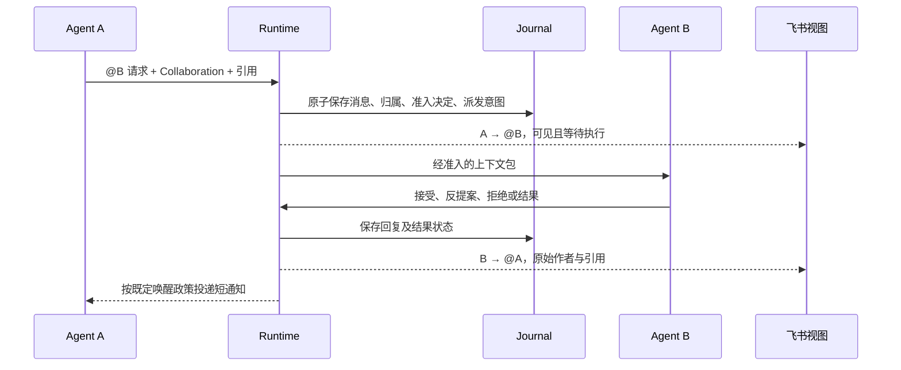

# 003 Execution

本章是执行、消息、预算和恢复行为的规则归属。对象见[Domain](001-domain.md)，启动和暂停权限见[Authorization](002-authorization.md)。以下均为拟采用契约，不代表已有运行时实现。

## 从月目标到下一段工作流

Lead根据有效Mission合同、已验收证据、未决问题和剩余额度提出下一阶段图。首版使用声明式步骤与依赖，不执行模型任意生成的脚本。程序检查引用、权限、预算、循环上限、截止与终止条件；合同内的可逆计划由获授权Lead接受，超出合同的变更形成给人的提案。

每个阶段应有可观察的产物和退出条件。先执行当前可验证阶段，不一次展开一个月的所有步骤。完成、反证、阻塞或合同改变后生成新的Workflow revision；已经派发的Attempt保留原版本，不能随计划修改而悄悄换义。

这保留dynamic workflow的“按任务生成控制流”，但首版不承诺Claude工作流脚本兼容，也不把六种模式做成六套执行引擎。原始模式与源码可见性边界见[三方研究](MULTI-AGENT-SOURCE-REVIEW.md)。

### 当前角色能否支持dynamic workflow

| 部分 | 可以沿用的基础 | 需要补齐或验证 |
|---|---|---|
| Lead规划 | 让执行Agent读取目标与证据后提出下一步；无需新建常驻规划服务 | 结构化阶段提案、稳定工作引用、受限分支、失败修正和停止条件；尚无完整规划闭环实测 |
| Router路由 | DSH的归属判断思路、明确对象直接寻址；已有直通成本小测 | 运行时能力表、权限内候选与费用归属；不让Router编写技术计划或调度任意脚本 |
| Worker | Hermes/Codex已有提示执行、工具调用及局部结果/消息证据 | 统一工作合同、结构化结束/等待/补证回报，以及独立成员之间的真实接入 |
| 运行时 | 可借鉴journal、准入、消息与缓存机制 | 阶段图校验、派发、等待、版本、费用和恢复尚未实现，是主要缺口 |

因此，现有能力提供了实现基础，不能仅加角色提示词就宣布dynamic workflow可用。采用“模型提出下一阶段＋程序验证执行”的路线；任意代码脚本和Claude私有协议兼容继续延期。

### 内核切片的阶段合同

Lead的planning Step直接归属Mission/默认Collaboration，先准入、后生成Workflow。提案必须包含当前合同/证据版本、既有Step引用或新工作合同、依赖、目标成员、交付/验收者、阶段额度、最大步骤/往返数、截止、等待事件和退出条件。模型不自行分配可绕过旧工作的身份。

内核只接受有限的Agent调用、等待已登记事件、结束阶段、请求人决定四类动作；条件来自结构化结果（完成、需补证、阻塞、拒绝），引用有限的下一动作或返回Lead重规划。未知动作、悬空引用、等待环、无界迭代、越权工具和超过阶段额度的图拒绝接受，不执行任意表达式。最多两个成员槽位，不做动态扩容。

结构检查通过不等于研究方案正确。语义验收由原合同规定的Owner承担，高影响判断才按合同审查。无效提案最多进行合同允许的有限修正，每次仍计费；无法修正则blocked。范围内的新同伴请求直接走Step准入，无需Lead转发或先重写整张图。

## Step与Attempt

Step是Mission内的逻辑工作，Attempt是一次真实执行。step_id由运行时分配且跨Workflow revision稳定；step_revision表示工作合同版本。Workflow可为空，规划、路由与纯消息工作同样可执行。编排位置step_key/item_key/iteration映射到该身份；续跑、重规划和换会话不生成新工作。真正的新循环工作可新建Step，但有界且保留来源；替换旧工作须声明supersedes_step_id并继承旧执行阻塞。

| Step状态 | 含义 | 主要后续 |
|---|---|---|
| planned | 合同已登记，派发依赖未满足 | ready、cancelled |
| ready | 派发依赖及其当前有效版本满足，等待准入 | running、blocked、cancelled |
| running | 存在执行中的Attempt | waiting_event、waiting_human、result_pending、failed |
| waiting_event | 已保存等待的事件与游标 | ready、blocked、cancelled |
| waiting_human | 有明确待决提案 | ready、blocked、cancelled |
| result_pending | 已持久化结果，等待规定的验收 | verified、ready补证、blocked |
| verified | 当前版本的验收完成 | 终态；证据过期另建复核工作 |
| blocked | 缺输入、授权、可用执行者或出现等待环 | 条件变化后ready，或cancelled |
| failed / cancelled | 工作失败或撤销 | 显式决定重试或替换，不能自动复活 |

Attempt状态另记dispatching、running、stopping、completed、failed、cancelled、unknown；其中dispatching通过派发记录区分未领取与已领取。Step暂停是独立控制标志，不擦除执行事实。任何旧版本或supersedes链上仍有活跃/unknown Attempt时，不得为替代工作再准入。新Attempt必须引用前次终态或能证明旧执行已停止/隔离的处置记录；人的一句“重试”不能把未知改成未执行。无关且已授权分支可以继续。

交付验收与进程退出分开。进程正常退出仍可能没有有效产物；超时后收到结果也不能自动推进已取消的Step。补证复用Step合同但新增Attempt；改变交付标准则另建Step版本。

结果复用以step_id、step_revision、当次input_set、权限/证据/产物指纹及验收有效性判断；Workflow位置仅提供来源，不因计划改版强制重做已完成工作。并行项身份不依赖完成顺序。恢复使用当时保存的输入与结果，不把现在的新消息冒充原始输入；纯计算可重算，模型调用、消息和外部动作不能因此重做。

## 工作流与直接mention的接缝

Agent A直接@B时，运行时解析收件人、请求类型和归属，不让另一个模型转述。凡会触发模型工作的消息，必须绑定既有Step，或创建归属某个Collaboration的新Step。纯通知只写消息，不凭空创建回合。

对等请求创建平级Step：费用记入共同Collaboration并汇总到Mission，不强制成为A的子任务。A等待B的回应使用wait_for(request/event)，回应可以是拒绝、补证或结果，不要求B先verified。只有A的最终交付确实需要B的有效结果时，才声明required_for，并标gate=acceptance；后续业务步骤必须先有B结果才能执行时标gate=dispatch。创建来源、生命周期、唤醒、结果依赖和费用归属分别记录。

回复默认进入原Step的待读输入；需要继续推理时，等待当前turn结束后再准入一个Attempt。A可为处理拒绝、补证、反提案而继续，不因尚未满足acceptance依赖被禁止讨论；这类续跑不能把未接受证据当已满足的业务前置条件，最终验收仍受原合同约束。内核切片不使用busy steer，也不提前把下一输入排进harness；先在运行时排队。后续只有适配器已证明安全steer、输入归属可追溯且该Step允许时才启用。轮数、期限、费用和验收者由协作合同限制。

Worker若尚未完成交付，结束回合时返回waiting及所等request/event；harness终态确认后，Step进入waiting_event或waiting_human并释放执行槽。回复先到则保存，原Attempt终结后可直接转ready；后到则由事件使等待Step转ready。恢复继续同一Step的新Attempt，不重新发送原请求。verified/cancelled/failed Step的迟到回复只留档；确需跟进时显式登记获授权工作，不自动重开终态。

## 消息与消费

| 状态事实 | 能证明什么 | 不能证明什么 |
|---|---|---|
| runtime_recorded | 消息进入本地权威记录 | 已发送到harness或飞书 |
| transport_accepted | 对端接口接收了请求 | 模型读到或任务执行完 |
| context_included | 适配器观察到已加入历史或输入 | 模型理解了内容；须注明观测层级 |
| response_recorded | 对应回复已持久化 | 工作结果已验收 |
| result_accepted | 规定的接受者接受具体结果版本 | 永久正确或无需过期复核 |

每条消息有稳定message_id、原始渠道ID、作者/收件人、Mission/Collaboration、目标Step、reply_to、有效合同版本和wake_policy。同ID同内容重试返回原记录，同ID不同指纹拒绝。必需请求通过持久outbox派发；渠道回显只更新投影，不能再次触发执行。

发送侧持久生成request_id，同一request_id与收件人只建立一次工作；恢复时回放原工具回执。模型重新生成不同ID的近似请求仍可能语义重复，不能承诺内容hash解决，须用协作轮数、额度和截止限制。

协作响应另记pending、accepted、declined、needs_evidence、answered；有现成答案可直接answered。它与传输回执分开，accepted只表示接下请求，answered也不代表Step verified。

准入阶段把消息归属、额度预约、Step/Attempt、input_set与派发意图一起落盘。input_set不可变，保存准备提交的完整payload及hash、message_id列表、当前合同/证据版本、预分配binding_id和逐消息消费记录ID；hash针对运行时提交内容，不冒充harness内部完整模型提示。每个收件Step的一条业务消息至多绑定一个尚未对账的消费Attempt；向不同授权收件人分别投递不相互覆盖。

原生session/turn ID、接收证据和后续游标可以晚于该事务出现，追加到binding/Attempt/消费记录并关联这些稳定ID，不回写不可变输入。会话建立先对账完成，再提交业务输入；create回执未知时不继续新建或提交。需要改变payload或证据版本时生成新的input_set并保留替代原因，不修改旧快照。

记录claimed_for_attempt、harness_received、history_committed（仅有证据时）、result_persisted等可观察事实，各自绑定Attempt、input_set和原生回执/游标；这些都不是“模型理解”。只有所有前序消息已完成处置或显式排除时才推进连续消费游标，不用游标替代逐消息记录。

提交成功但回执丢失进入unknown：凭绑定的request/session/turn及输入hash查询原Attempt，不另建消费Attempt。明确未提交才能释放消费绑定重新准入；已提交但工作失败的后续重试须显式引用原输入与失败记录，不伪装成新消息。没有可查询证据则阻塞，不凭缺少本地回执重发。模型结果、输入处置状态与Step迁移同事务落盘；非模型回执和迟到费用继续独立接收。

### 派发与暂停的顺序

| 顺序 | 持久动作与边界 |
|---|---|
| 登记 | 原子保存准入结果、输入、预约和pending intent；尚未获得外发资格 |
| 领取 | outbox worker在同一事务检查当前暂停/合同/协作版本、dispatch依赖有效性、额度、session空闲、旧unknown；通过才写claimed和绑定版本 |
| 外发 | 事务外调用harness；已领取的请求保守视为可能在途。发送前若观察到撤销则不调用；不可把网络发送与数据库暂停宣称为一个原子动作 |
| 暂停/改目标 | 更新控制版本，禁止领取旧pending intent；已claimed的Attempt取消并对账，不能按未发送重新派发 |
| 回执 | 按原Attempt/input_set落盘；只有版本仍适用且未暂停才验收/推进 |

控制更新和派发领取有确定先后；“暂停生效”表示禁止新增领取，不承诺暂停前领取的网络请求此刻已经停止。队列、定时器、重试和重规划均使用同一领取检查，不能只有首次准入检查。

摘要与评审读取固定快照，不能推进业务收件箱消费游标。业务处理也只能确认自己实际取走的记录。普通来源通知可以合并；必要请求、授权变更和人工暂停不能被合并掉。适配器必须声明实际唤醒行为，不能把“QueueOnly”之类名称当成绝不会唤醒的保证。

无法阻止原生通知自动启动模型时，普通inform保留在运行时，待下一获授权回合注入。重复投递前核对待处理收件箱和可观察历史，避免旧副本与重投副本同时进入回合；消费证据不可见时保留unknown。

## 等待与生命周期

等待保存所等对象、游标、期限、超时动作和预算。由事件或定时器唤醒，不循环调用模型问“结束了吗”。只有确认harness当前turn结束后才释放执行预约；本地wait工具仍占用活跃turn时不能把它记成已卸载等待。

检测dispatch依赖和真实wait_for构成的等待环；没有外部进展来源时标blocked并交给该协作Owner处理，不靠增加Agent解决。acceptance门槛不能被误作禁止处理同伴回复的派发环。创建Agent分为准备、对端接受、绑定完成三段：接受前失败可清理本地预约，接受后丢回执先查询，未知状态不再次spawn。

身份、会话驻留和并发额度分别管理。节点断线不代表进程死亡，租约过期只阻止新的准入；旧执行是否结束需要实际回执或隔离证据。

## 费用账本

运行时账本是Mission费用权威。每次模型响应登记独立usage_event_id、Attempt、harness请求ID、模型、input/output/cached tokens、计价版本和报告来源。重试按真实响应分别收费；同一响应重复上报去重。thread/turn ID只能归属费用，不能单独作为去重键。

压缩、Router、Lead规划、Reviewer、失败调用和恢复验证都计费。累计计数接口先计算差额，避免每次把累计值再加一次；无法获得分项则标unknown，不填零。缓存tokens包含关系遵从提供方口径，不能与input重复相加。实际账单未可核对时只报告估算金额。

派发前检查并预约额度，响应后按实际结算并释放预约。未知在途费用保留预约或不确定上界，不能因进程重启清零。并行在途请求可能超出预算，首版承诺软停止：到限后关闭新增准入并请求取消，继续收集迟到费用。需要严格金额硬限而提供方没有强制机制时，不承接该保证。

参考[预算边界验证](g0-g2-2026-11-16/boundary-validation/budget/README.md)：原生预算、冷恢复与外部统一账本不能混为一谈。

首版允许有可靠序列的累计快照差额作为会计事件，不要求把它虚构为一条provider响应。记录counter_scope、epoch、sequence、上次基线与coverage；跨重连或重启必须核对是否重置，同一增量不同时以逐响应事件再入账。聚合量可核对而逐请求明细缺失时，保留总量并标注明细不可见；总量也不可靠则保留未知预约并停止新增相关工作。实际适配限制见[Architecture](007-architecture.md)。

## 证据有效性与后继准入

历史verified不等于永远可用。计划中的required_for可先引用尚未完成的上游Step/合同版本及gate，此时为unresolved，不要求规划时已有Decision。dispatch依赖在准入事务创建input_set时选择并固定适用Decision及证据版本；之后的派发领取只校验该固定绑定，不能改写快照或换成最新版。acceptance依赖在最终验收事务选择并固定到验收记录，同时复核实际输入中已固定的dispatch依赖。未满足dispatch不能执行依赖它的业务工作，未满足acceptance不能将结果置verified。

已绑定Decision须仍accepted_for_use或满足conditional条件，未stale/contested且符合当前Mission；不得在恢复或验收时静默改用“最新Decision”。来源更新与已知依赖失效标记一起入库；重新绑定需明确复核决定及新的输入集合或验收记录，旧版证据保留。wait_for回复事件本身不是结果有效性保证。

失效使具有相关dispatch依赖的未派发后继blocked，并创建有归属的复核工作；已在途工作标requires_revalidation，保存输出但不得直接验收或推进。仅acceptance门槛未满足时，可处理异议或补证，不能完成验收。复核通过生成新Decision，由Owner确认后继输入适用性后重新准入。opaque依赖不能精准传播时，对关联里程碑保守复核。对无法通知变更的外部来源，仅保证规定核验点的观察，不承诺实时知晓所有变化。

## 检查点与月级连续性

检查点至少包含有效合同及暂停状态、计划版本、已验收产物、反证与被排除路线、未知项、关键来源版本、消息消费游标、活动/未知Attempt、已花费与预约、下一项验证及其触发条件。恢复摘要只是这些事实的可重建索引。

原始产物按artifact ID、hash和来源定位保存。活跃Mission引用的快照不可被普通清理删除；网页URL与设备本地路径都不足以保证可恢复。敏感或不可长期存储的来源应声明保留限制，并把无法重取视为能力边界。

| 恢复时的状态 | 处理 |
|---|---|
| 已验收产物且输入仍适用 | 复用，不重新调用模型生成 |
| 只有本地未派发意图 | 通过当前准入后派发 |
| 对端已接受或可能已接受 | 查询对账；未知则阻塞，不盲重放 |
| 等待事件／人工决定 | 恢复游标、定时器与暂停，不启动无事可做的模型 |
| 会话丢失但事实完整 | 新会话加载恢复包；不承诺迁移KV缓存或私有推理 |
| 关键来源过期／缺失 | 标stale/unavailable，补证或保留未知，禁止猜测 |
| 新合同与旧结果并存 | 保留旧结果，重新判断适用性，不自动推进新目标 |

阶段结束、关键决策前、恢复后和关键来源变更时检查目标一致性。比较成功标准、证据增量、可用产物与风险减少，不能用消息数或token量衡量进展。否定一个有根据的假设也算进展。

建议默认：连续两个有意义检查点无证据进展，触发一次有上限的诊断，随后仍无进展则暂停该分支并提交具体选择。该阈值可由合同调整，不另设常驻“进度审查Agent”。通知政策见[Panel](005-panel.md)。

目前只验证过局部消息、预算与合成召回；真实压缩、跨设备冷恢复、72小时至30天连续运行仍需[分阶段验收](006-deployment.md)。

下一篇：[004 Prompts](004-prompts.md)。
