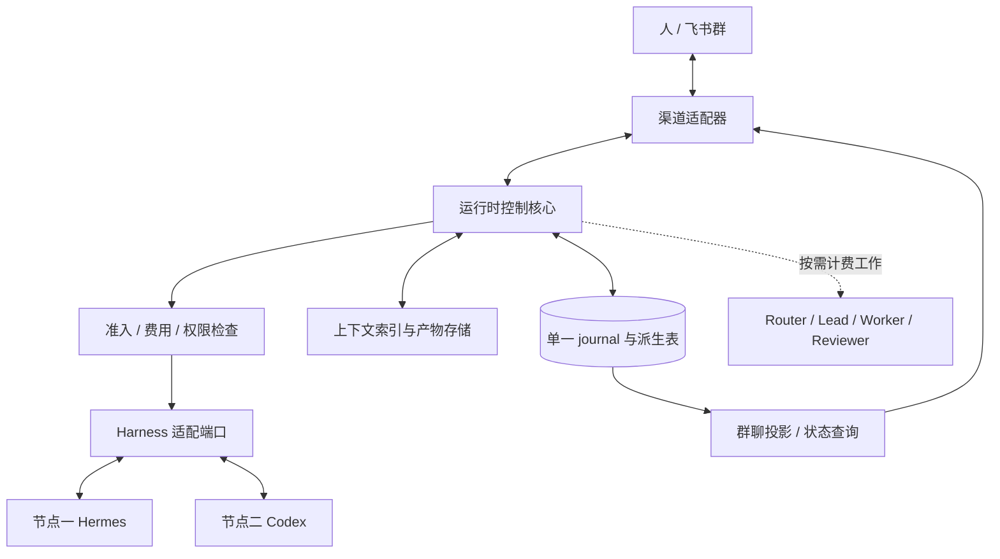

# 007 Architecture

本章定义模块边界、持久化记录和适配契约。行为规则分别归属[Authorization](002-authorization.md)与[Execution](003-execution.md)，不在这里建立第二套状态机。

## 运行时是独立基础能力

Router是可选模型角色，不是所有消息必经的模型中间人；路由、准入和派发是三个不同动作。上下文索引负责查找和版本，产物Owner负责知识接受，存储组件不判断结论真假。

控制核心只依赖端口契约，不导入具体harness核心。Agent角色通过同一执行路径调用harness，不能绕过账本。节点只拥有执行绑定与可重传回执，不成为任务目标或费用的第二权威。

图展示完整首版；内核切片将两个执行适配器放在同机，不先建远程节点代理。阶段校验器只解释[有限动作合同](003-execution.md)，不运行模型任意代码。逻辑Step先于Workflow存在，计划是其编排视图，避免让规划调用依赖自己尚未生成的计划。

## 单一持久化权威

建议初版SQLite内保存journal及同事务更新的当前状态表、inbox/outbox和费用表；它们是同一个权威存储的事实与物化状态，不是两套需要业务对账的工作流引擎。产物正文可放独立文件存储，通过hash和引用关联。

journal只记录已接受的状态变更与必要执行意图，不声称能从事件流重放所有外部副作用。恢复读取持久状态并对账外部Attempt，不重新执行过去的模型调用。Temporal和另一套工作流权威暂不引入。

### 建议记录结构

下表是逻辑数据契约，具体SQL迁移尚未实现。所有时间使用有时区时间；带version的更新使用预期版本比较，失败后重新读取，不能覆盖并发决定。

| 记录 | 主键与主要字段 | 约束 |
|---|---|---|
| missions / mission_revisions | mission_id；revision、目标、标准、权限引用、Owner、期限、预算、pause | 唯一有效revision，历史不可覆盖 |
| collaborations | collaboration_id；mission_id、成员、Owner、范围、额度、收敛条件、version | 额度汇总到Mission，不形成额外可花总额 |
| steps / step_revisions | step_id；mission_id、collaboration_id、kind、step_revision、合同、supersedes_step_id、状态 | 身份独立于Workflow；工作修订保留身份，替代链不能绕过旧unknown |
| workflows / workflow_members | workflow_id＋revision；step_key/item_key/iteration → step_id＋step_revision；带gate的结果依赖与待绑定/已绑定Decision | 编排位置唯一；Step可无Workflow；未完成上游可先unresolved引用 |
| attempts | attempt_id；step_id/revision、input_set_id、adapter/node/session/turn、request_id、配置快照、状态 | 同逻辑Step跨版本/替代链至多一个活跃或unknown执行；单session只一个受控turn |
| agents / bindings | agent_id；能力、角色；binding_id、设备、会话、配置版本 | 身份与在线状态分离；绑定变化可追溯 |
| messages / deliveries | message_id；作者、目标、归属、request_id/reply_to、指纹、协作响应；delivery_id、目标通道、回执状态 | message_id冲突须比内容；request_id＋收件人唯一工作；各通道送达分别记录 |
| decisions | decision_id；对象ID/version、接受者、依据、条件、决定及当前有效性 | 历史验收保留；过期Decision不能满足新的后继准入 |
| context_items / dependencies | item_id＋version；来源/hash、适用范围、接受状态；依赖及观测等级 | 保留反证；没有完整依赖时不声明完整stale传播 |
| artifacts / checkpoints | artifact_id、hash、位置、保留策略；checkpoint_id、合同/计划引用、恢复快照 | 活跃引用不可普通清理；摘要不是原始证据 |
| input_sets / message_consumption | input_set_id；Attempt、提交payload/hash、消息及合同/证据版本、binding/消费记录ID；消费记录另存证据/游标 | 输入快照不可变，原生回执在关联记录追加；每个收件Step的同消息至多一个未对账消费绑定 |
| reservations / usage_events | reservation_id、Attempt、额度；usage_event_id、实际tokens/provider units、来源、计价、counter scope/epoch/sequence、coverage | 逐响应或可靠累计差额只结算一次，不同时叠加；未知费用不清零 |
| inbox / outbox / timers | 外部事件键、指纹、游标；意图ID、pending/claimed/回执、绑定版本；定时器及版本 | 事务内写意图，领取时重新检查控制版本；已claimed结果未知不当未发送 |
| journal | event_id、aggregate_id/version、事件类型、因果引用、时间 | 追加事实；与相应状态及outbox原子提交 |

### 消息合同

| 字段 | 含义 |
|---|---|
| message_id / payload_fingerprint | 内部稳定身份与内容冲突检查 |
| origin | 认证来源、平台事件ID、真实作者、权限范围 |
| sender_agent_id / recipients | 逻辑直接寻址；不从正文自述推断身份 |
| mission_id / contract_revision / collaboration_id | 工作和授权归属 |
| step_id / step_revision / request_id / reply_to | 执行与回复关联；新工作先登记独立Step，不要求已有Workflow |
| kind | request、reply、evidence、handback、control等受控类别 |
| body / artifact_refs | 原文或内容引用；记录敏感级别与来源 |
| wake_policy / expires_at | 是否通知、等待当前turn、可否安全steer、何时失效 |
| required_for / wait_for | 可选结果依赖含gate=dispatch或acceptance；等回复事件另记wait_for，不要求对端先verified |

kind=control不是授权依据。控制命令仍核验认证人、目标版本和操作权限；同伴发来的“批准”只能是普通数据。

## 适配端口与能力报告

端口描述语义，不假设四个harness有相同函数。适配器要报告supported、unsupported、unknown，并附版本、入口、证据等级和限制；source_only与tested不能混用。启动时核对所需能力，缺失则降级或拒绝相关Step。

| 语义操作 | 必须返回或声明 | 缺失时的处理 |
|---|---|---|
| 发现能力与当前配置 | 实际模型、工具/skills、权限、版本、并发限制 | 无法证明所需权限/能力则不准入 |
| 建立／恢复执行绑定 | 请求ID、session/thread ID、配置、接受边界 | 不可幂等且结果未知时禁止盲重建 |
| 提交输入 | client request ID、目标Step/Attempt、接受回执、busy语义 | 本地串行排队，不假设原生去重 |
| 投递同伴消息 | 作者、目标、正文/引用、实际wake行为 | 可经外部受控工具实现；不可审计正文不能充当公开群聊证据 |
| 观察／查询 | 可重连游标、状态与终态证据、观测层级 | 不可查询的断链执行标unknown |
| 取消 | 请求已接受与真实终态分开 | 关闭新准入，保留在途未知；不声称已停 |
| 获取usage | 逐响应或累计口径、cached包含关系、报告标识 | 标unknown并保留预约；不可无账本继续长程运行 |
| 读取产物与来源 | 版本/hash、权限、可用性、依赖可观测范围 | 只记录可知依赖；关键源缺失时阻塞或补证 |
| 释放会话／节点 | 可确认结束、残留资源和重连策略 | 活跃或未知执行不能只删本地记录 |

生命周期接入和群聊展示可以使用不同接口，但必须归入同一执行记录。原生API没有的功能可以由适配器实现，不得仅换个名称便宣称语义等价。

首版默认由运行时创建和绑定成员，不开放未纳管的原生子Agent树。只有子线程的身份、权限、usage和取消/恢复都可覆盖时，才允许接入原生再委派；否则会突破单一账本和准入边界。

## 内核切片的实际适配路径

下面区分已有实测入口、当前源码可见接口和待实现组合，不把接口存在当成接入完成。证据版本仍以原报告为准，本次只做静态核对。

### Hermes Gateway加外部薄插件

| 责任 | 选择的路径与证据 | 仍需证明 |
|---|---|---|
| 建立与执行 | 使用`hermes gateway attach --json`发现/认证，协商`hermes-gateway-v1`、`runtime.describe`，调用`session.create`及`prompt.submit`；保持原request_id/input_id | 独立运行时对Gateway的组合尚未实现；禁止用工作区HEAD替代运行版本 |
| 终态、取消、重连 | `prompt.receipt`/`prompt.cancel`、`session.events.since`、`session.resume`；按epoch和游标复核 | 已有同进程局部烟测，不保证Gateway冷恢复；回放缺口先快照对账 |
| Agent发消息/读证据 | 外部插件经`ctx.register_tool`注册最少工具，处理器调用运行时端口；不改Hermes核心或stock工具表 | 插件尚未编写；toolset选择、输入/回执绑定与实际生效权限需静态和最小集成验收 |
| 作者与执行归属 | 依据受信handler上下文的session_id/task_id及已保存绑定寻找当前Attempt，消息参数不接受自报作者授权 | 缺绑定、来自摘要fork或未纳管子树则拒绝；压缩换session时先重建绑定 |
| usage | 先核对Gateway终态usage；公开`post_api_request`、`post_auxiliary_call`等观察钩子是补齐逐调用的候选路径 | 源码可见不等于安装版覆盖全部辅助调用；需验证ID、重复报告、失败及压缩覆盖 |

插件通过公开API注册，不能直接导入私有会话控制模块。处理器返回持久message_id/request_id回执，不阻塞等待同伴模型；接收侧由运行时在空闲且获准时用`prompt.submit`注入input_set。忙时消息在运行时排队，原生排队能力仅作已知边界，不作为首版预排多回合的依据。

当前普通工具handler的上下文并未直接透传tool_call_id，不能把观察钩子的字段当成handler必有参数。首个方案以显式request_id＋受信会话绑定做业务幂等，公开pre/post工具钩子作为原生调用关联候选；同一请求指纹冲突拒绝，工具回执重传必须复用原ID。工具回执在中断/压缩后的准确关联尚需验证，未证明时不能启用自动重放。

conversation_id可跨压缩保持，但委派子Agent可能共享它；session_id又可能随压缩轮换。两者都不能单独当逻辑Agent ID，需与运行时绑定、真实调用来源及当前受控Attempt一起核验。无会话上下文的调用不回退为默认Agent。

依据：[Hermes G1](g0-g2-2026-11-16/hermes/G1-evidence.md)、[插件注册](/Users/season/workspace/github/hermes-agent/hermes_cli/plugins_context.py:272)、[公开handler上下文](/Users/season/workspace/github/hermes-agent/website/docs/developer-guide/plugins/index.md:887)、[实际工具派发](/Users/season/workspace/github/hermes-agent/model_tools.py:851)、[用量观察钩子](/Users/season/workspace/github/hermes-agent/website/docs/developer-guide/plugins/index.md:1609)。

### Codex公开AppServer加dynamicTools

运行时通过`thread/start`为每个由Codex承载的成员建立独立持久线程，将最小dynamicTools直接注入各线程；Hermes＋Codex双成员切片只需一个Codex线程，不额外启动两个。它不依赖原生spawn继承，也不让原生子树绕过成员控制。已存在且兼容的线程优先续用，经准入后`turn/start`执行输入；busy时运行时排队，不把它当独立新turn提交。

`item/tool/call`的threadId、turnId、callId来自服务端请求，与运行时绑定共同认证作者和Attempt。消息工具只写journal/outbox并立即返回持久回执；Worker可报告waiting并结束。接收者在原turn终态后，通过下一次获准`turn/start`读入input_set，不采用持有工具回调等待同伴的长期收件方式。

以`turn/completed`和`thread/read`核对已知turn及结果，`turn/interrupt`请求停止，`thread/resume`候选用于恢复绑定。clientUserMessageId不是去重保证；没有拿到turn ID时即使线程存在也不证明输入未被接受，必须对账或保持unknown。

`thread/tokenUsage/updated`及线程快照有total/last口径；持久化基线后取差额。单thread仅一个受控turn有助归属，但断连快照仍可能缺逐请求明细。只承诺实际可观测的聚合量与coverage，不把一段累计差额拆成虚构provider事件；原生units与商业金额另记。源码Host准入/记账扩展仍不作为公开AppServer必有能力。

依据：[公开正文实验](g0-g2-2026-11-16/boundary-validation/messages/README.md)、[协议与冷恢复fixture](g0-g2-2026-11-16/codex-dsh/README.md)、[公开工具参数](/Users/season/workspace/github/codex/codex-rs/app-server-protocol/schema/typescript/v2/DynamicToolCallParams.ts:6)、[usage类型](/Users/season/workspace/github/codex/codex-rs/app-server-protocol/schema/typescript/v2/ThreadTokenUsage.ts:6)。旧正文实验采用原生父子Agent和回合内等待，只证明该公开工具路径的局部能力，没有证明这里的独立线程组合。

### 接入停止条件

不能从受信调用映射唯一成员/Attempt、无法保存可恢复输入、消息路径会绕过暂停唤醒、或费用总量不可对账时，该路径不能宣称G-A/B通过。先补薄适配器或限制能力；不以增加治理Agent替代接入缺口。Gateway冷恢复、真实压缩绑定轮换、独立线程双向消息和辅助费用覆盖仍待验证；本次不动态运行OpenClaw/DSH。

## 四个harness的证据定位

| Harness | 当前可依据 | 首版不能假定 |
|---|---|---|
| Hermes | Gateway局部实测支持请求去重/冲突、排队、取消、观察者回放、同进程resume | Gateway冷恢复、完整read_set、跨harness闭环已通过 |
| Codex | AppServer局部实测、dynamicTools公开消息交换；本地源码可核对多Agent核心 | clientUserMessageId原生去重、内部Host接口已公开、原生加密消息体可公开审计 |
| DSH | 原型文档及路由、投递、事务effects等源码依据 | 已完成独立运行时适配或动态验证 |
| OpenClaw | 待补静态能力映射，动态接入延期 | 四框架统一能力已成立 |

详细版本与测试范围见[研究入口](README.md)及[三方源码报告](MULTI-AGENT-SOURCE-REVIEW.md)。适配器需继续核对本机版本，不能用这张表替代运行时能力协商。

## 值得采用的源码机制

| 来源 | 采用或条件采用 | 不直接照搬 |
|---|---|---|
| DSH Router与所有权 | 明确Owner直达、无归属才路由、保留原请求引用、handback、context-only区分 | 固定卡片长度、每条通知必调模型、把订阅当授权 |
| DSH事务effects | 域变化与执行意图同事务、完成时核对代际、delivery ID去重 | 把写入历史当理解；把外部effect当exactly-once |
| Claude本地快照 | 直接peer消息、闲时事件唤醒、摘要分支不消费业务邮箱 | 文件邮箱当可靠分布式队列；未经验证的快照当官方产品保证 |
| Codex生命周期与准入 | 区分身份/驻留/并发，按实际执行上下文授予permit，接受前后清理边界 | 私有Host扩展作为首版公开依赖；用本地Drop保障远端恢复 |
| Codex消息板 | 持久记录先提交，短通知随后，request ID＋内容指纹 | 通知成功等于工作完成；数据库可写等于有权发布 |
| Codex费用与子配置 | 逐响应计费含压缩，捕获实际有效权限与配置 | 原生预算当严格硬限；fork默认等于省总tokens |

Claude源目录真实性未经独立确认，引用仅表示本地观察。当前源码报告也未在该快照找到完整dynamic workflow执行实现，不能从产品文章推断具体内部恢复代码。

## 决策边界

已纳入设计：混合上下文、按需Router、平级协作Step、稳定消息ID、持久outbox、外部费用账本、版本化证据、人工控制与有界恢复。

建议默认而非既定事实：一个控制实例、SQLite、一个桥接机器人、单组织信任域和通知节奏。待验证：真实群聊、两设备断线、统一usage、冷恢复、真实压缩、质量收益和30天连续性。延期：任意代码工作流、多控制实例容灾、OpenClaw/DSH动态适配与全协作模板库。

下一篇：[008 Cookbook](008-cookbook.md)。
