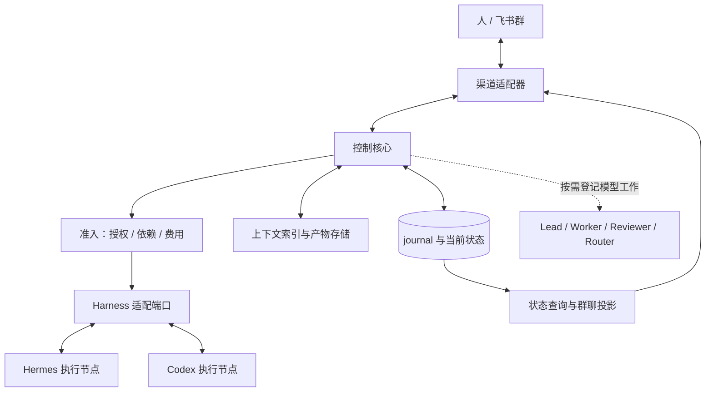

# 007 Architecture：状态怎样保存，harness 怎样接入

前几章定义了工作规则，本章说明哪些模块执行这些规则，以及哪些事实必须保存。授权以 [002](002-authorization.md) 为准，状态转换以 [003](003-execution.md) 为准；适配器不能建立另一套更宽松的恢复或授权规则。

## 独立运行时的模块边界

图展示完整首版。内核切片把两个适配器放在同机，省去远程节点代理，但保留相同的绑定和回执语义。

控制核心管理授权版本、工作归属、状态转换和执行准入；上下文组件管理来源、索引和有效性，知识是否可采纳由合同指定的接受者决定。渠道适配器呈现已有事实，执行适配器连接 harness。二者均不成为业务状态的第二权威。

Router 是按需调用的模型角色。直接寻址由程序完成，Router 只为归属不明的已授权工作提出建议。Lead 提出下一阶段，有限动作校验器检查提案；内核切片不执行模型生成的任意代码。所有模型角色都走同一准入和记账路径。

运行时核心只依赖端口契约，不导入 Hermes 或 Codex 的私有控制模块。Hermes 插件是外部适配器；其他 harness 也分别映射自身公开接口，不要求它们修改成同一种内部结构。

## 一份权威存储，保存事实和当前状态

建议在同一个 SQLite 数据库中保存 journal、当前状态表、inbox/outbox 和费用记录。它们在同一事务内更新：journal 解释发生了什么，当前表便于查询。产物正文可以独立存放，以内容 hash 和稳定引用关联。

恢复从持久状态出发，查询原执行并核对回执，不重新调用历史模型。journal 记录事实和意图，不承诺重放外部副作用。内核切片因此不引入 Temporal 或第二套工作流权威。

### 逻辑数据合同

下表描述记录职责，尚不是已实现的 SQL。时间含时区，变更带预期版本；并发版本不符时重新读取，不能覆盖另一项决定。

| 记录 | 必要信息 | 核心约束 |
|---|---|---|
| missions / mission_revisions | 目标、标准、禁止项、任务授权人、期限、权限、风险分类、允许调整范围，以及暂停范围和控制版本 | 当前有效版本唯一，旧授权不覆盖 |
| collaborations | 归属、成员、交付负责人、范围、额度、收敛条件和版本 | 额度是 Mission 总额的分配，不产生额外总额 |
| steps / step_revisions | 稳定 ID、工作合同、当前修订、替代关系、当前 Attempt 引用、业务状态及控制标记 | 状态按修订记录；阻塞保留原因、先前阶段与等待；三个控制标记遵循 003 |
| step_dependencies | 所属 Step 修订、依赖 ID、上游引用、dispatch/acceptance 门槛、设立依据及变更权限 | **唯一的执行依赖定义**；未完成上游可待绑定，修改须经授权并产生新修订 |
| workflows / workflow_members | 计划版本、编排位置、Step 修订与依赖 ID 引用 | 仅组织已有工作；删除计划节点不删除其依赖或历史 |
| dependency_bindings | 依赖 ID、所用 Decision/证据版本、input_set 或验收引用 | 明确某次派发或验收采用了哪个结果，不能用后来版本覆写 |
| attempts / attempt_dispositions | Attempt 归属、请求与配置快照、原生执行关联、状态；处置依据、批准人、范围、残留风险 | 终态与处置分开；处置可解除特定阻塞，同时撤销旧 Attempt 推进业务的资格 |
| agents / bindings | 逻辑成员身份、角色、设备、会话、配置版本、绑定是否退役 | 在线状态不是身份；已退役绑定不接新工作 |
| messages / deliveries | 作者、收件人、原请求、回复关联、正文指纹；通道投递及回执 | 同 ID 不同内容拒绝；接收请求不等于业务验收 |
| decisions | 对象及版本、接受者、授权来源、依据、审查条件、适用性 | 历史决定保留；过期决定不满足新的依赖检查 |
| context_items / context_dependencies | 来源、版本/hash、范围、知识状态、证据引用及观测等级 | 此处记录知识来源关系，不替代 step_dependencies 的执行门槛 |
| artifacts / checkpoints | 产物 hash、位置、保留策略；目标、控制、证据、待办和恢复引用 | 活跃引用不可普通清理；摘要不能替代原始证据 |
| input_sets / message_consumption | 固定 payload/hash、合同与证据版本、消息及接收者、Attempt、消费凭证 | 输入快照不可变；原生 ID 后到时追加关联，不改原输入 |
| reservations / fee_provisions / usage_events | 额度预约、未结费用准备、真实用量、计数范围/epoch/序列及 coverage | 预约与准备均占可用额度；准备不是实际费用；累计和逐响应不重复相加 |
| inbox / outbox / timers | 外部事件身份与指纹、执行意图、领取状态、控制版本、等待期限 | 事务内保存；领取时复查；已领取但未确认不能当作未发送 |
| journal | 事件 ID、对象版本、因果引用、事实、时间和操作者 | 追加保存，与相应当前状态及执行意图原子提交 |

同一逻辑工作跨修订和替代链，最多有一个活跃或尚未获准处置的未知 Attempt；同一会话最多有一个受控回合。此约束在准入事务中检查，而不是交给提示词。若批准了未知执行处置，应能查到解除的是哪条阻塞、依据是什么、哪些费用仍占额度。

例如，A 的验收要求 B 独立核对。该门槛属于 A 的 Step 修订，Workflow 只引用它。Lead 删除图中的 B 节点不能使 A 自动通过；必须按 [依赖变更规则](002-authorization.md#dependency-changes)处理。重新验收时，dependency_bindings 另记实际采用的新 Decision，保留原绑定供追溯。

### 消息合同

| 字段组 | 含义 |
|---|---|
| `message_id` / `payload_fingerprint` | 稳定身份与内容冲突检查 |
| `origin` | 认证来源、平台事件、真实作者及权限范围 |
| `sender_agent_id` / `recipients` | 逻辑直接寻址，作者由受信绑定确定 |
| `mission_id` / `contract_revision` / `collaboration_id` | 工作与费用归属 |
| `step_id` / `step_revision` / `request_id` / `reply_to` | 执行及回复关联；纯消息工作也先登记 Step |
| `kind` / `body` / `artifact_refs` | 受控消息类别、原文或引用、来源和敏感级别 |
| `wake_policy` / `expires_at` | 何时可以触发输入、何时失效；内核切片使用空闲后准入 |
| `wait_for` / `proposed_dependencies` | 等待哪个回复事件，以及建议增加的结果依赖 |

消息可提出 `required_for` 依赖，但它只有在授权检查后写入 step_dependencies 才生效。`kind=control` 同样不是权限：人的批准核验身份与版本，同伴正文中的“已批准”只是来源数据。

## 适配端口描述语义，不伪装统一实现

每项能力报告 `supported`、`unsupported` 或 `unknown`，附实际版本、入口、证据等级和限制。源码可见、合成 fixture 通过、真实执行通过分别记录。准入根据当前 Step 所需能力判断，不能以一个笼统的“已接入”替代。

| 操作 | 返回或声明 | 缺失时的行为 |
|---|---|---|
| 查询能力与实效配置 | 版本、模型、工具/skills、权限、并发限制 | 无法证明必要能力时拒绝相关工作 |
| 建立或恢复绑定 | 请求身份、session/thread、配置、接受边界 | 接受情况未知时先查询，不盲重建 |
| 提交输入 | input_set/Attempt 关联、客户端请求 ID、接受回执和 busy 行为 | 由运行时串行排队，不假定原生去重 |
| 同伴消息工具 | 受信作者、目标、原文和持久业务回执 | 不可认证或不能持久化时拒绝，不降级成不记账的私聊 |
| 观察与查询 | 游标、状态、原生终态和观察范围 | 断链无法确认则标 `unknown` |
| 取消与停止证明 | 请求已接受、是否终态、是否有隔离证据 | 继续对账，不能仅凭取消请求释放执行占用 |
| 获取用量 | 原生单位、逐响应或累计口径、计数范围和覆盖项 | 保留未知费用及预约，不以零继续花费 |
| 读取来源与产物 | 版本/hash、可用性、权限和读取可观测范围 | 关键源缺失时补证或阻塞；黑盒读取标不可见 |
| 释放绑定或节点 | 结束证据、残留资源和重连策略 | 活跃或未知执行不能靠删除本地记录结束 |

生命周期和工具回调可使用不同接口，但必须关联同一个 Attempt。默认只允许运行时创建和纳管的成员；原生子 Agent 树只有在身份、权限、用量和取消/恢复都可覆盖时才允许接入。能力声明本身并不能阻止未纳管子调用，仍需核验实效配置和执行限制。

## Hermes：Gateway 加外部薄插件

选择 Gateway 负责会话生命周期，外部插件提供最少的协作工具。规划中的 `collab_send` 保存消息并立即返回持久回执；证据读取工具提供受控来源。接收者空闲且获准后，再由运行时提交固定 input_set。插件不持有模型回调长期等同伴，也不导入私有控制模块。

| 责任 | 已有入口与证据 | 接入时仍需补齐 |
|---|---|---|
| 建立与执行 | T0 静态核对 `hermes gateway attach --json`、`hermes-gateway-v1`、`runtime.describe`、`session.create`、`prompt.submit` | 确认存活 Gateway 版本，验证与独立运行时的组合 |
| 查询和取消 | `prompt.receipt`、`prompt.cancel`、`session.events.since`、`session.resume`；历史有同进程局部烟测 | Gateway 冷恢复、回放缺口及在途接受边界 |
| 插件加载 | T0-P 通过公开 discover/register/`ctx.register_tool` 路径 | 产品插件、真实模型工具选择和持久业务回执 |
| 身份 | 普通 handler 接收 task/session/conversation；合成缺失、旧绑定、子会话及伪造目标被拒 | 正常 Gateway 回合如何可信地映射唯一 Attempt；压缩后的重绑定 |
| 用量 | 终态 usage，以及 `post_api_request`、`post_auxiliary_call` 公开观察钩子候选 | 主调用、辅助调用、失败、流式尾账和压缩覆盖，重复报告关联 |

T0-P 使用源码 `cf02ef9e5196649b0884b0fd4e9ca341b42cc9bb`、Python 3.14.9，未启动 Gateway 或 AIAgent。它不能更新历史 Gateway 的运行版本结论。完整版本、路径与哈希保存在 [T0 基线](kernel-slice-validation/capability-baseline.json)及 [T0-P 记录](kernel-slice-validation/preflight/README.md)。

### safe_mode 的替代配置仍需完整验证

环境 safe mode 会跳过插件加载，会话 safe mode 会移除插件工具，因而不适合作为保留协作插件的配置。候选路径是隔离 profile，设置 `safe_mode=false`、`ignore_user_config=false`、`yolo=false`，显式选择协作 toolset，并关闭 `tools.tool_search.enabled`。T0-P 的最终直接工具表只有测试用 `collab_send`；这是配置观测，不是完整权限证明。

底层 `handle_function_call` 即使收到工具选择参数，仍可调用未选中的测试工具。公开 `pre_tool_call` 拒绝钩子阻止了该测试调用，说明有可用扩展点；钩子异常、超时、跳过路径、并发 profile 和完整 Agent 执行层尚未验证。不能把工具展示过滤视为授权闸门，也不能把该底层探针描述为已经证实的完整 Agent 越权。

未来若启用 Tool Search，需要重新验证桥接身份与权限，并在新会话固定工具表。插件不靠提示词承担隔离责任。

### 身份和业务回执怎样关联

普通 handler 没有原生 turn_id/tool_call_id；观察钩子有某字段，也不代表 handler 一定收到它。初步方案以显式业务 `request_id`、正文指纹和受信会话绑定核验当前 Attempt。重复请求复用持久回执，内容冲突拒绝。当前测试返回的 JSON receipt 尚不是这个产品回执。

conversation_id 可能跨压缩保留，也可能被子 Agent 共享；session_id 又可能随压缩变化。二者均不能单独作为逻辑成员身份。缺少唯一绑定就拒绝，不能回退为默认 Agent。中断、压缩或工具重放后的准确关联仍需验证，未证明前不开启自动重放。

## Codex：公开 AppServer 加动态工具

每个由 Codex 承载的成员使用独立持久线程。Hermes 与 Codex 双成员切片只需一个 Codex 线程；无需为“多 Agent”再启动原生子树。运行时经 `thread/start` 建立绑定并注入动态工具，配置兼容时续用线程，通过 `turn/start` 提交下一份输入。busy 时在运行时排队。

`item/tool/call` 带服务端 threadId、turnId、callId，与运行时保存的绑定共同确定作者和 Attempt。发送工具先保存消息，再返回回执。接收者在旧回合终态后读取下一份 input_set，不长期占用工具回调等待。

### T0-P 的冷恢复证明到哪里

安装二进制为 `0.169.0-alpha.11.1`，其构建提交未被证明等同于本地源码。真实 AppServer 对接本机合成 Responses provider，验证了能力门控、动态回调和以下恢复路径：旧回合 completed → 关闭旧进程 → 同一 CODEX_HOME 启动新进程并 initialize → `thread/resume` 只传 threadId → 查询旧 turn → 新 turn 再次调用同一工具。恢复时没有重新传入工具定义。

该版本实际工具声明位于 `input.additional_tools`，`collab_send` 经 `functions.exec` 调用后产生原生回调。适配器必须检查有效工具声明及真实回调，不能比较空的顶层 tools 数组就宣布恢复成功。未声明 experimentalApi 时，dynamicTools 被拒绝且未触发 provider。

恢复前后合成累计值为 26 和 52，说明这条测试路径中的计数可延续。它们由 fixture 人工给定，不是实际成本校准。`thread/tokenUsage/updated` 和线程快照的 total/last 应保留基线、epoch 与 coverage；累计差额与逐响应明细不重复相加，cached/reasoning 分项也不再次加入 total。

### 工具限制和在途恢复仍是缺口

T0-P 发现只关闭 multi_agent/multi_agent_v2 仍会暴露原生协作工具，还需 `agents.enabled=false`。即便如此，仍存在 exec、wait、用户输入、clock，以及 exec 内的 apply_patch、goal、resource、view_image 等工具声明。当前不能承诺“只有协作工具”。read-only/never 配置被接受，但文件写入限制和人类审批流程尚未作执行验证。

`turn/completed` 和 `thread/read` 用于查询原执行，`turn/interrupt` 是取消请求。clientUserMessageId 不构成原生去重保证；未拿到 turn ID 时，线程存在也不证明输入未被接受。T0-P 没有覆盖待决工具 RPC、在途模型请求、丢回执及未知费用窗口，不能将终态后的冷恢复扩大为这些能力。此类场景仍按 [003](003-execution.md#unknown-disposition)保留未知并单独验证。

## 接入何时必须停下来

无法认证唯一成员/Attempt、无法保存可恢复输入、消息会绕过暂停，或必要费用无法对账时，相关路径不能宣称 G-A/B 通过。可以限制能力或补适配器，但不能用增加管理 Agent 代替这些缺口。

| Harness | 当前证据定位 | 当前边界 |
|---|---|---|
| Hermes | Gateway 历史局部烟测；T0-P 真实加载器与派发器的零模型测试 | 尚无 Gateway 冷恢复、真实绑定和完整费用覆盖 |
| Codex | 公开通信历史证据；安装版终态后动态工具冷恢复 fixture | 尚无本设计的跨 harness 闭环、在途恢复和完整权限证明 |
| DSH | 原型理念、路由、投递和事务 effects 的文档与源码 | 动态接入延期 |
| OpenClaw | 静态能力映射仍待补齐 | 动态接入延期，不阻塞当前切片 |

历史正文实验使用过原生父子 Agent 和回合内等待，只证明当时公开工具的局部能力，不能替代这里的独立线程组合验收。依据集中于 [T0](kernel-slice-validation/adapter-preflight.md)、[T0-P](kernel-slice-validation/preflight/README.md)与[原始消息实验](g0-g2-2026-11-16/boundary-validation/messages/README.md)，不使用会随工作区变动的行号当作固定版本证据。

## 从已有系统采用什么

| 来源 | 采用的机制 | 保留的边界 |
|---|---|---|
| DSH 路由与所有权 | 已知负责人直达，保留原请求，支持交还与仅供上下文的投递 | 卡片长度不是已验证最优参数；订阅不产生授权 |
| DSH 事务 effects | 状态与执行意图同事务，完成时核对版本，投递按 ID 去重 | 外部副作用不因此获得 exactly-once 保证 |
| Claude 本地快照 | 直接同伴消息、空闲唤醒、摘要分支不消费业务邮箱 | 文件邮箱不是分布式可靠队列；快照真实性未经独立确认 |
| Codex 生命周期与准入 | 区分身份、会话驻留和并发，按实际执行取得许可 | 私有 Host 扩展不是公开 AppServer 的接入承诺 |
| Codex 消息与费用 | 持久记录先于通知，ID 加内容指纹，捕获实效配置及压缩费用 | 原生预算不是严格硬限；fork 不必然降低总 tokens |

详细依据见[三方源码报告](MULTI-AGENT-SOURCE-REVIEW.md)。该报告未在 Claude 快照中找到完整 dynamic workflow 实现，因此本设计采用公开机制的思路，不声称复刻其内部执行代码。

下一篇：[008 Cookbook：怎样逐步接入和验证](008-cookbook.md)。
