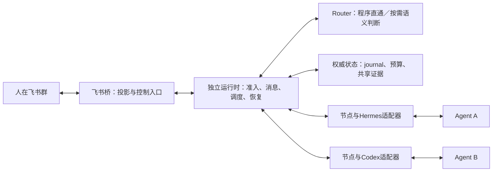

> 历史归档：V3.1单篇稿，2026-11-16。正文保留，局部链接因移动目录而调整。当前规范请读[分类文档入口](../README.md)。本稿不再维护。

# 独立协作运行时收敛设计

2026-11-16 · V3.1 · 待实现的设计基线。本文完整取代V1/V2，历史稿归档在[archive](../archive/collaboration-runtime-v2-2026-11-16.md)，不再要求读者合并旧章节。V3.1合并[Claude Code、DSH与Codex源码证据](../MULTI-AGENT-SOURCE-REVIEW.md)，不扩大首版组件范围。设计中的“采用”表示推荐纳入实现，不表示能力已经实现或验收通过。当前没有产品代码、部署或通知配置。

目标：让人通过现有飞书群，指挥跨Hermes/Codex的Agent推进软件工程、量化研究、市场调研等任务；任务可跨会话、进程和设备，持续最长一个月。用户授权、目标、证据、成本和未完成工作由独立运行时保存，harness负责具体推理与工具执行。

## 1 已确定的方向和首版取舍

用户已确定：独立模块与适配层、多种协作关系、Agent直接mention且群聊可见、Router与共享上下文、动态工作流、分布式执行。当前接入优先Hermes/Codex；OpenClaw/DSH延后。飞书临时patch只是适配现状，不定义正式协议。

推荐采用一个逻辑控制服务和轻量节点代理：程序处理准入、订阅、投递、等待、计量与恢复，模型只处理确需语义判断的路由、规划、执行和评审。对等协作在授权范围内直接发生，不经中间模型转述。

两种替代路线暂不采用：把协作内嵌某个harness会破坏独立性；完全对等、多控制节点的联邦会提前引入授权冲突和恢复复杂度。逻辑控制服务不限制Agent之间的对等讨论，但会成为首版可用性边界。

**我的首版部署建议，尚不是用户已确认的基础设施选择：**一个控制实例、一个组织管理范围、1–2个受信执行节点；控制实例使用本地SQLite事务库和journal，节点经API访问，不共享数据库文件。它替代V2未经验证的PostgreSQL默认值，以降低安装成本；若已有必须沿用的数据库，可保持同一事务契约接入。SQLite适用前提是控制端串行短事务，不是跨设备直接共享文件；多控制实例/高并发写入时再考虑服务型数据库。[SQLite适用边界](https://www.sqlite.org/whentouse.html)

首版面向受监督的试用，不承诺无人照看运行一个月。分布式接口纳入首版，验收先单机闭环、再两设备；两设备验收通过后才能标为支持分布式执行。无需先建设这些组件才能继续低成本评估协作质量。

图中的运行时负责可靠投递；A发给B的原文与作者身份保持不变，不由另一模型转述。共享上下文经版本引用读取，群聊投影不成为新的执行请求。

## 2 实验证据如何改变设计

| 结果 | 设计采用 | 不能推出的保证 |
|---|---|---|
| 原G2双Agent总tokens为单Agent6.5倍，两组都满分 | 默认单个执行Agent；额外协作由需要触发，所有治理成本计入 | 尚无多Agent质量优于强单Agent的证据 |
| 四条件小测中直通少一次Router调用，短资料内联更省总tokens | 已知归属走程序直通，批量处理已可确定的事件；紧邻必需资料内联 | 单次差异不是稳定节省率；批处理尚未实测 |
| 长资料32KiB下内联16,689、按需22,882；96KiB下内联27,301、按需22,866 | 低相关长档案外置，保留索引并支持批量读取 | 32–96KiB不是通用阈值，更不是金额阈值 |
| 三消息公开动态工具路径可逐字核对发送/日志/接收 | 运行时控制的消息入口、可读正文与回复关系 | 原生Codex send_message仍无公开明文审计；未验证持久消息恢复 |
| 新会话、过期摘要、静默过期及两类断链小测通过 | 恢复以原文证据、版本、可寻址关系为基础；缺证保留unknown | 未证明真实压缩后长期记忆或月级任务达标 |
| Codex原生预算共享但可在途超额；新turn仍可请求，冷恢复会重置 | 外部持久账本、宿主准入、未知消耗保留；原生预算仅附加保护 | 首版不承诺严格金额/token硬上限 |
| Hermes输入幂等、取消及观察端重连有实测；Codex冷恢复历史有fixture证据 | 按各适配器真实能力接入、恢复前对账 | Hermes进程冷恢复、跨harness透明迁移尚未验证 |

证据：[原G2与计量](../g0-g2-2026-11-16/README.md)、[三消息审计](../g0-g2-2026-11-16/boundary-validation/messages/README.md)、[预算反例](../g0-g2-2026-11-16/boundary-validation/budget/README.md)、[四条件及基础召回](../g0-g2-2026-11-16/superagent-pilot/README.md)、[长资料与无预警召回](../g0-g2-2026-11-16/superagent-long-pilot/README.md)。后两轮分别283,190和186,885 tokens，每条件一次、合成资料、缓存冷热未控制、非独立盲评；不把总tokens当成账单费用。

## 3 最少的对象和职责

| 对象 | 持久内容 | 责任边界 |
|---|---|---|
| Mission | 当前及历史目标版本、禁止项、验收标准、授权人、期限、预算、里程碑 | 一个月任务的身份；不依附群消息、Kanban或某个会话 |
| Collaboration | 参与者、共享范围、允许互动方式、费用账户、收敛条件和截止时间 | 一次委派、审查、协商或交接的范围；可包含多个平级Step |
| Workflow revision | 下一阶段的控制图/脚本、版本、输入、停止条件、依赖 | 可由Agent生成，运行时验证并保存；不自行扩权 |
| Step / Attempt | 输入快照、完成条件、状态；每次尝试的Agent/节点/会话/turn/费用与回执 | 所有模型工作有归属，包括路由、规划、回复与恢复检查 |
| Message / Decision | 正文、作者、收件人、回复关系、提案/接受/拒绝及版本 | 消息送达不是结论被接受，也不是工作已完成 |
| Context item / Artifact | 原文或产物、hash/版本、来源、适用范围、支持/反证、当前采用状态 | 外置事实和结果；摘要是可重建的视图 |

人员只需一个具名Mission Owner；执行侧常态一个Lead/Owner角色，需要时加一个同伴。本文Mission Owner指人类授权人；Collaboration/产物Owner指被明确授权的交付责任人，可以是Agent。Lead可兼任下一阶段规划者，Reviewer按任务触发。Router不是常驻的大模型进程；首版不设独立Memory Agent、Progress Agent或多层管理团队。

逻辑Agent身份与当前节点/session绑定分开。一次Step结束不删除其地址，成员可在没有活跃回合时接收待处理消息；后续按准入恢复或重建会话。成员数量、驻留会话数量和运行中Attempt数量分别观测，首版无需自动淘汰算法。harness原生父子树只表示创建来源和生命周期关系，不替代平级Collaboration。

### 协作关系与工作流模式是两条轴

| 协作关系 | 谁决定什么 | 首版 |
|---|---|---|
| 委派 | 请求方给任务契约，被请求方执行 | 支持 |
| 对等协商/共同审查 | 各参与者可提出证据、反例、反提案或拒绝；具名产物Owner负责交付，不能抹掉分歧 | 支持有界双Agent协商 |
| 交接 | 原Owner提出移交，接任者确认任务/授权/未决项后接管；确认前原Owner仍负责 | 支持显式交接，不承诺迁移私有会话状态 |
| 共享证据协作 | 参与者发布证据、订阅相关变化，各自决定如何使用 | 支持小范围订阅；不自动唤醒所有成员 |
| 竞争选择 | 独立候选按共同标准比较 | 延后专用模板 |

交接接受须绑定当前owner revision，并在一个事务内替换Owner；并发接受只有一个成功。变更Owner不增加权限或预算，也不自动迁移正在执行的Attempt。

Claude六种工作流模式保留为可组合控制方式：classify-and-act、fan-out-and-synthesize、adversarial verification、generate-and-filter、tournament、loop-until-done。它们不替代上述协作关系。首版提供分类/直通、单次独立审查、有界循环；其他组合可后续扩展，不先造齐模板库。[模式来源](https://claude.dev/blog/a-harness-for-every-task-dynamic-workflows-in-claude-code/)

## 4 Router 程序优先 语义判断按需

Router有四项职责：解析逻辑Agent/任务地址；检查能力与节点可用性；选择上下文入口；把未明确归属的事件提交一次有界语义判断。准入政策独立于模型建议，由程序最终检查。

| 输入 | 路径 | 是否唤醒路由模型 |
|---|---|---|
| 明确@B且Collaboration有效 | 校验身份、范围、预算与B能力，直达B收件箱 | 否 |
| 已订阅话题的回复/证据 | 按订阅和游标去重；只给相关成员投递，按需唤醒 | 否；若Worker退回为范围外请求才重新判断 |
| 新请求、对象歧义、任务交接不清 | 先按显式ID/引用查找，再调用轻量Router判断候选 | 必要时一次；仍不清楚才向人确认 |
| 心跳、回执、工具结束、已知计时器 | 程序更新状态或唤醒绑定的Step | 否 |
| 目标变更、扩大权限或预算 | 形成有版本的提案，等待具备权限的人决定 | 模型可解释影响，不能批准 |

不能从话题相似就把两个任务合并。明确收件人不可静默替换；B离线时消息保留queued，或按已批准的替代规则交接。Router只传原文、引用和路由事实，不重新写技术计划。节点调度使用能力、数据位置和负载，首版不训练学习型Router。

订阅是获取上下文的资格，不是执行授权：inform通常只更新待读入口；request才可触发准入。已有事件可合并一次唤醒，保留每条ID及顺序；人的暂停/撤销立即进入控制状态，不等批处理。首次创建新工作、冷启动和完成状态观察由宿主完成，避免模型为spawn/wait产生可省的续跑。

请求的负责者和context-only订阅另行记录。已有负责者先处理范围内请求；超出范围时以原request_id记录handback与原因，全部负责者退出后才重新路由，避免Router与Worker重复接单。退回不赋予新权限、不创建新请求ID；以轮数和截止时间阻止来回退回。路由与技术规划即使由同一逻辑Agent承担，也分别登记执行角色。

## 5 共享上下文 把可恢复的状态放在会话之外

### 三层内容

1. **控制事实：**完整目标原文、有效授权、禁止项、人工暂停、当前目标版本。来源是具名人类决定及运行时状态，模型摘要不能覆盖。
2. **可采用的证据与判断：**来源记录、实验结果、当前采用的判断、反证和未决项。每项有版本及接受依据。
3. **每次执行的上下文包：**绑定Step输入游标；内联当前目标/约束、当前步骤、相关消息和近期必需证据，其余保留ID、短描述、版本和批量读取入口。

共享的是可寻址的事实和关系，不是每轮向所有Agent复制同一份大摘要。群聊可见不等于所有成员都订阅，更不等于每个模型都读取全文。

协商正文与证据先写入同一权威库，通知只带ID、版本和短摘要；通知失败不使已提交记录消失，恢复按每个订阅者的持久游标补读。明确request另受可靠投递和Step准入约束，不能退化为尽力通知。共享帖子证明“谁说过什么”，不会自动变为accepted知识。摘要、恢复卡和独立评审只读指定快照，不得确认业务消息已消费或修改Owner。

首版上下文策略用简单规则：必需且短的信息内联；低相关大正文外置；相关引用可以批量展开。记录实际补读次数与整轮用量，按任务类型调节，**不把32–96KiB写成硬阈值**。固定基础提示与工具表，变化作为追加的带版本输入；避免照搬DSH每请求重组提示词的方式而破坏Hermes缓存前缀。

每个Attempt记录实际生效的model、effort、提示/工具指纹、插件状态、保留输入、权限快照与fresh/fork方式，不能由fork=none推断零继承。恢复以当前授权重新检查，不让旧配置恢复已撤销权限。同harness前缀fork是待验证优化，不是默认跨harness能力或稳定省钱保证。

摘要必须带来源和产生时的版本。关键结论入验收或动作准入前，重新读取当前控制事实，并检查关键来源版本；发现不一致则补读原文。普通工作摘要不能批准行动。过期来源标为stale/needs_revalidation，缺失为unavailable，不自动补造；摘要中的旧值不能覆盖新证据。

### 谁接受知识

| 内容 | 接受者 | 接受含义 |
|---|---|---|
| 用户目标/暂停/权限 | 认证的人类Owner；程序保存决定 | 改变任务合同，不声称改变客观事实 |
| 工具运行/测试/数据记录 | 程序核验回执与版本；异常交产物Owner | 确认记录和检查结果，不推导无限正确性 |
| 日常可逆研究判断 | 具名产物Owner | 带来源、范围和有效期的working judgement |
| 会影响里程碑或后续大额工作的结论 | Owner结合一次独立Reviewer意见接受，或保持争议 | 接受为当前工作依据；异议、条件必须保留 |
| 方法争议、重要证据冲突无法解决 | Owner做一次有界补证；仍影响目标/授权则请人决策 | 不把“多数Agent同意”当真理 |

研究结论允许conditional或contested，不把一切堵在人类审批。市场结论保留口径与日期，量化结论保留数据版本、泄漏/验证方法，工程结果关联commit与行为检查。首版不建设领域专家角色体系，按每个任务的验收合同指定接受者和证据门槛。

状态至少有 proposed、accepted_for_use、conditional、contested、rejected、stale、superseded。摘要要继承条件和未知项。来源不可信与结论不确定分别记录。

### 依赖追踪的有限保证

分别保存运行时注入依赖、适配器观测依赖、Agent自报依赖。Hermes/Codex内部工具或shell可能绕开观测，因此首版默认observed/declared/opaque，不宣称完整read_set。只有关键输入通过被强制限制的受控入口时，才可声明该范围enforced。

已知依赖变更时精准标记；覆盖不完整时，对关联数据集、工作区或里程碑保守触发复核。没有命中read_set不等于结论仍有效。正文按hash/版本保存；跨设备引用产物ID、Git commit或快照，不使用本机路径作为唯一身份。

## 6 Agent 互相 mention 与工作流如何配合

### 统一消息与执行归属

一条消息至少包含：message_id、mission_id、collaboration_id、sender_agent_id、recipients、kind、reply_to/request_id、body/body_ref、source_kind、goal_revision、execution_ref、context_refs及wake_policy。身份由认证的适配器绑定，不能由正文自报；重试沿用同一message_id。

wake_policy区分仅排队/更新上下文、申请启动或继续回合；由准入程序校验，发送者不能借字段绕过暂停。适配器声明真实唤醒行为，不能仅按send_message/followup等工具名推断。若原生通知可能自动启动模型且无法受控，inform暂存运行时，待下一授权回合注入。控制信号优先于业务请求和可合并通知，不能被peer聊天淹没。

| 情况 | Step归属 | 费用与恢复 |
|---|---|---|
| A正在执行时收到相关回复 | 安全边界注入当前Step；否则排队 | 绑定具体turn/输入游标；记当前Step费用 |
| A等待回复，回复需要模型处理 | 唤醒原Step的新Attempt | 从已保存输入及回复恢复，不重新发请求 |
| @B请求新的审查/调查 | 准入后在同一Collaboration登记B的Step | 默认用Collaboration额度；与A为平级合作Step，不自动成为required child |
| B把工作显式委派给C | 登记委派Step，并声明依赖关系 | 可使用委派子额度；父子只汇总一次真实消费 |
| inform或群聊投影 | 记录消息和待读索引 | 默认不唤醒模型；若需分析，先登记执行Step |

脚本和mention走相同的Step/Attempt/journal/预算入口。脚本决定阶段门和必须等待的结果；Agent在阶段允许的协作范围内自行选对象、提问、反驳或交接。`required_for`必须显式声明，不能因“是谁@谁”自动产生依赖。对等协商可由两个平级Step共同提供结果，Owner不能把未解决争议写成共识。

发送方持久生成request_id；同一request_id+recipient只建一次工作。Agent在重试中重新产生不同ID的相似请求，属于语义重复风险，不能靠内容hash保证去重。适配器须回放原工具回执，另以轮数、额度、截止时间限制循环。

### 投递和接受是两个状态机

消息传输：recorded → queued → delivered，失败保留重试/阻塞原因。协作响应可由pending进入accepted、declined或needs_evidence；接受后提供答案进入answered，补证后可再次接受。无需新模型工作的已有答案可以直接answered。Step只有达到自己的验收契约才verified；answered或delivered都不能直接成为verified。

delivered仅表示适配器所声明的接收边界；另存输入消费证据：harness接收、history_committed、实际可观测的request/turn receipt及结果持久化回执，均关联message_id、Attempt与游标。不能把入队或进入内存历史标成provider成功读取，更不能标成已理解。适配器无法观察的层级记unknown；同一ID重投前先核对历史和待处理收件箱，防止旧副本与重投副本同时进入下一回合。消息消费权只属于绑定的业务Attempt。

消息入库、去重、工作准入决定及待派发intent在同一事务登记。拒绝执行的消息可以保留可见，但不能偷偷启动模型。关闭协作范围与创建新Step用同一版本检查；关闭后迟到消息只留档，不能自动重开工作。等待释放执行槽；A/B互相等待由依赖图检测为阻塞，交给本协作Owner处置，不新建第三个常驻调解Agent。

创建成员/Attempt须保存spawn_request_id和接受回执：接受前取消清理临时资源；已接受后调用方断线不自动撤回新任务；结果未知先查询绑定，不能重新spawn。程序等待输入活动可减少模型轮询，但harness内部wait工具可能仍占活跃turn；只有确认停在可恢复边界或结束原Attempt后，运行时才释放执行槽。

### 飞书中的呈现

首版建议一个桥接机器人作为渠道出口，正文显式显示逻辑Agent作者与收件人，例如“A → @B：请核对数据版本”，并带任务/话题及回复关系。Agent彼此请求通过运行时消息通道投递；飞书是可读投影和人的控制入口。语义上的直接协作不依赖飞书机器人是否能唤醒另一个机器人，也不需要Router模型中转。

群内显示请求、质疑、证据摘要、回应、接受/拒绝和阶段结果，不展示隐藏推理或全部工具流水。状态/回执更新尽量编辑原消息；同一message_id的投影不再次生成业务事件。桥接回流依据平台message_id、已保存outbox映射及认证机器人身份去重，不能只靠正文标签防回环。

多个真实机器人头像、原生@对应机器人和既有patch可作为渠道增强，但不纳入未经实测的承诺。首版仍需验收实际飞书入站/回复链/出站重试；若无法查询已发送结果，状态标为发送结果未知，不盲重发。人类可直接@某个逻辑Agent，也可批准/否决、暂停/恢复或改目标；自然语言“好”只在唯一明确且仍有效的提案中生效。

### 人工暂停和恢复的确定行为

认证的人类暂停写入控制事实后，立即禁止该范围新派发、新turn、后继推进与自动验收，并向活跃Attempt请求取消。取消请求不等于已停止：未确认终态的Attempt保持stopping或unknown，仍计费。已发送的外部动作不能宣称被撤回；节点断网时暂停的强制效果受节点连通性限制，故首版排除自主高影响外部写入。

暂停期间的迟到消息、结果和费用仍留档，但不自动采纳或推进。只有具备权限的人明确恢复才能解除人工暂停；恢复先核对当前合同、来源及原Attempt终态。原Attempt仍活跃或结果未知时只对账，不启动重复Attempt；原Attempt已结束时，经重新准入继续原Step或采纳兼容结果。改目标则生成新revision，旧结果先待复核。人工暂停既不被超时解除，也不因模型、数据消息或重启解除。

## 7 动态工作流与一个月任务的连续性

### 谁写下一段 谁决定执行

Mission Owner先确认目标、成功标准、禁止项、预算和可自动调整范围。Lead只为下一个可验收阶段生成工作流提案，输出Step、依赖、上下文需求、产物、验收、预算估计、停止条件及失效时的处理。首版不生成覆盖一个月的巨大脚本。

运行时先做结构检查：依赖是否成立、步骤ID是否稳定、循环/并发是否有界、适配器是否满足权限/恢复要求、费用是否有额度、mention窗口如何收敛。范围内的可逆计划由已授权Lead接受；改变目标、验收标准、禁止项、总预算或权限必须交人类。高影响方法变化可按合同要求一次独立审查，不为每段工作流常驻一个Reviewer。

首版选择由Lead生成声明式控制图：顺序、条件、有限并行、持久等待、有界迭代、调用Agent。动态性来自观察结果后生成下一阶段或新的有版本计划，而非预先写死一个月的路径。所有I/O经宿主登记。受限代码脚本编译到同一控制图是后续作者接口，首版不开放任意JavaScript执行；未来引入时仍需进程隔离和能力限制，不能把普通语言沙箱当成权限边界。Claude式动态生成与调用结果复用是借鉴方向，不承诺其私有API或恢复实现兼容。

每段结束、出现新反证、授权变化或达到预定检查点时再规划下一段；重规划也是计费Step。等待外部结果时保存job handle和唤醒条件，不反复唤醒模型询问进度。

### 每个检查点保存什么

- 当前完整目标原文及版本、禁止项、未撤销的人工暂停、预算已耗/预留/未知量。
- 已验证产物和未通过的验收项；采用/否决的方案及原因，重要反证、争议、来源版本。
- 正在运行和等待的Step/Attempt、节点/session/turn绑定、输入游标、未处理消息、外部操作receipt。
- 下一项可检验预期、到期条件、阻塞和需要人的决定；用于启动新会话的短恢复卡及原文引用。

这份检查点不覆盖原始记录，也不要求每次由模型重写完整历史。程序保存执行事实；Owner仅更新判断、依据和下一步。基础提示保持稳定，长期变化放入有版本的任务输入。会话压缩仍由harness处理；跨会话连续性由上述外部状态保证目标，不依赖压缩摘要完整无误。

活跃Mission的恢复证据和所引用产物不得因普通缓存清理被删除；可保存的外部资料保留带版本快照，无法保存的来源记录获取条件与失效风险。一个月后只剩不可访问的URL不算可恢复检查点。

Step的最小状态如下，人工暂停是独立控制标志，不覆盖原执行状态：

| 状态 | 可以怎样推进 |
|---|---|
| planned / ready | 依赖满足且当前合同、权限、预算准入通过，才创建Attempt |
| running | 对应一个活跃Attempt；接收输入须有回执和游标 |
| waiting_event / waiting_human | 原Attempt先停在可恢复边界或确认结束，再释放执行槽；记录唤醒条件 |
| result_pending | 收到结果，按当前验收合同验证；暂停时只保存 |
| verified | 验收通过，允许满足后继依赖；过期须重新验证 |
| blocked / failed / cancelled | 保存原因；经明确决策与准入才创建新Attempt，不默认无限重试 |

Attempt另记dispatching、running、stopping、completed、failed、cancelled、unknown，避免把harness完成等同于Step验收。unknown必须先对账；Step在重试时保持同一身份，Attempt身份递增。

### 重启或更换会话后的恢复次序

| 已保存状态 | 恢复动作 | 禁止行为 |
|---|---|---|
| Step verified且输入/目标版本仍兼容 | 返回已有产物和验收receipt | 不因新会话再做一遍 |
| 派发intent已写但尚未提交harness | 查attempt状态，再派发 | 不创建新的逻辑工作ID |
| 可能提交成功，回执丢失 | 优先inspect/reconcile原session/turn/input；无法确认则unknown | 不把“无结果”当作“从未执行” |
| Step waiting_event / waiting_human | 重建订阅/持久计时器，保持原暂停 | 不用超时或bot消息当批准 |
| 原会话可安全恢复 | attach/resume同一尝试并核对终态 | 不重置外部费用账户 |
| 原会话不可用、需换harness/设备 | 从恢复卡和原始证据开启新Attempt，先核对关键约束/状态 | 不宣称迁移了私有推理、KV缓存或原生子树 |
| 目标/来源版本变化 | 保留旧结果，标needs_revalidation，经当前版本验收后复用 | 迟到旧结果不能推进新目标的后继 |

恢复检查首先比较完整合同、人工否决/暂停及关键证据原文，再继续执行。即使summary声称“可运行”，也不能绕过当前控制状态；来源不可读就保留unknown并停止依赖它的关键步骤。静默过期小测通过只是模型能做这件事的证据，运行时仍需建立版本/来源核对机制。

### 如何判断一个月里有进展

运行时间、消息数和token消耗不计作成果。每阶段记录验收项变化、可复现产物、新反证/排除的假设、阻塞解除及未决风险。软件看行为和提交证据，量化看预先声明的方法与数据检查，市场看关键问题证据及矛盾消解；负结果可以是有效研究进展。

建议默认：连续两个具备取证/验收机会的检查点没有新证据，只允许一次有预算上限的诊断；仍无进展则暂停该分支并请求具体决策。长实验依据约定的中间结果判断，不按一天未结束误判。最终完成必须满足合同验收，不能因时间或预算耗尽而宣布成功。

通知由程序汇集已有证据；阶段结果、关键阻塞、预算接近不足或需人改变范围时发送。建议每日最多一份有变化才发的摘要，每周提供可选里程碑复核；未替用户启用任何频率。人可查看当前目标差异、实际成本、证据、未完成项，并暂停/纠正/接管。无人响应只暂停相关依赖分支，不视为批准。

## 8 单一权威状态 分布式执行与预算

### 持久化最小集合

| 记录集合 | 主身份和必要约束 |
|---|---|
| mission及revision | mission_id+revision；有效合同唯一，审批与版本绑定 |
| collaboration/step/attempt | 明确状态、归属、lease及harness绑定；一个session仅一活跃受控turn |
| journal/inbox/outbox | event_id/message_id唯一；业务状态与待派发intent同事务；游标可恢复 |
| context/artifact/decision | item_id+version/hash；当前采用状态、接受者、来源与异议 |
| usage/reservation | attempt/turn及provider事件去重；累计快照按差额处理；未知费用不记零 |
| checkpoint/timer | 绑定mission/workflow版本和触发事件，重复触发不重建工作 |

首版一个事务库作为控制权威，正文可在内容寻址文件存储中，hash写入库。节点本地缓冲只存待重传回执，不裁决全局计划或预算。不开Temporal、不维护第二套工作流权威；数据库、必要产物和索引一起备份，备份恢复后先核对可能丢失的执行回执，再允许自动派发。

调用结果复用身份为workflow revision + step key + item key + iteration及输入/权限/产物指纹。并行使用稳定item key，不依赖完成顺序。纯计算可重算；模型结果、消息、等待和副作用均保存。重放消费已记录事件，不能用“现在查到的新消息”冒充当时输入。目标变更是新revision，不对未知副作用做盲重放。

### 分布式边界

节点主动认证连接控制服务，注册设备能力、harness版本和数据位置。首版一个控制实例，无自动主备切换。节点用attempt身份和租约接单，回执附相同身份；旧尝试迟到结果可审计、计费，但不能覆盖新尝试或旧目标版本。

断网时控制端停止给该节点新工作，节点保留结果并重传；失联不等于失败，不因心跳丢失就自动在别处重做。首版不开放离线新任务准入。已有计算只能在已授予的范围内收尾；无法强制中止的harness标draining/unknown。跨设备重分配须先确认旧工作结束或已隔离；否则等待核对。

首版跨设备步骤限于隔离工作区内的可检查产物与只读取证。交易、任意生产写入、自动发布等高影响外部副作用不纳入自主闭环。确需外部写入时以独立操作intent、授权及可查询回执接入；不支持查询/幂等的动作不能承诺自动恢复。一个journal不能使任意外部API具备exactly-once。

### 成本和授权分别控制

每个模型调用至少归到一个Step/Attempt；路由、规划、协商、评审、摘要、失败及恢复均计费。共享Collaboration账户允许平级参与者消费；委派子额度是分配，不把同一实际usage重复累计。总输入、缓存输入、输出、provider units、金额各自保存。

压缩与辅助推理也纳入覆盖检查；同一turn可有多笔模型响应，thread_id+turn_id只是归属，不是费用去重键。适配器提供可持久复用的usage事件ID或可靠累计序列；报告重试只重传账目，不重新执行推理。控制责任必须选定：主账本由运行时持有，原生账本仅二级保护；缺用量或结算结果未知不能回退记零。提供宿主记账扩展的harness也不等于提供逐请求硬预算。

首版在派发前检查已耗+在途估计+未知额，超限不启动新Step/turn，向活跃执行发停止请求并等待真实终态；预算耗尽状态跨重启保留。每阶段设并发、轮数和超时，适配器暴露原生预算作二级保护。**这仍是软停止**：黑盒内部调用、在途响应及工具可能超额。要求严格金额硬限的任务暂不支持，直到逐模型请求准入、最大请求成本及重试可控被验证。

预算不是工具授权。来源不可信的网页/群消息只作数据；读外部内容的Agent使用低权限环境，不能同时持有生产写权限。受信执行者读取其摘要也不把摘要变成授权。Quarantine作为权限隔离要求采用，但尚无本项目端到端安全验收；不能靠source_kind字段宣称抗注入。[隔离思路来源](https://claude.dev/blog/a-harness-for-every-task-dynamic-workflows-in-claude-code/)

## 9 适配器能力契约与首版范围

核心不导入具体harness包。适配器必须先报告每项能力的支持状态（supported / unsupported / unknown），以及支持判断的证据等级（verified / source_only / untested）和版本；实际任务按最弱环节降级，不能统一函数名就统一保证。

模型协作工具、成员控制契约与harness执行适配分别承担职责。对寻址、唤醒、回合准入、取消、用量、消费回执、恢复分别声明控制责任和证据；保留成员身份、原始请求、当前权限及有效配置。Codex源码中的AgentControl和Host准入/记账扩展为分层提供参考，但它们是Rust嵌入契约，当前未验证可由公开App Server安装。首版不依赖其普遍可达，也不让一项不支持的能力静默退回更弱的执行策略。

| 契约 | Hermes现有证据 | Codex现有证据 / 首版处理 |
|---|---|---|
| create/inspect及身份绑定 | 原生Gateway会话与admission实测 | App Server thread/turn；运行时逻辑身份独立绑定 |
| submit及去重 | request/input ID实测去重和冲突 | clientUserMessageId不去重；宿主intent、回执与查询对账，未知提交不盲重发 |
| events/终态/cancel | 流、回放、精确取消；取消回执可能仍started | item/turn事件、interrupt；必须观察真实终态 |
| context及可读协作工具 | 需通过插件/受控工具接入，尚未完成跨harness回环 | dynamicTools三消息明文路径已实测；稳定性按版本锁定 |
| checkpoint/reattach/resume | 观察端重连已测，Gateway进程冷恢复未测 | 同机冷恢复历史fixture已测；预算必须外部恢复 |
| usage/子任务边界 | 有原生用量，完整辅助调用覆盖待核 | 必须聚合所有实际线程，累计量取差；首版默认由宿主创建成员，不开放未纳管原生子树 |

首版实现边界为：独立控制服务/SDK、节点代理、Hermes与Codex适配器、一个飞书桥、事务journal和产物库。协议保留OpenClaw/DSH扩展位，当前不实现、不动态验证。推荐独立仓库发布；当前文件只借DSH原型工作区存放研究，不把第三方运行时写进Hermes或DSH核心。

首版必须交付的一条最小闭环：一个Mission → Lead生成一个短阶段 → Hermes/Codex各承担一个明确角色 → 双方直接mention请求/质疑/回复 → 证据采纳或争议留存 → 人在飞书暂停或纠正 → 进程重启后恢复同一工作及账本 → 验收产物。范围内同时支持纯消息发起的协作，不能只有脚本能产生Step。

首版不包含：四harness全适配、六种模板全库、持续群聊广播、通用向量记忆平台、自训练Router、多个治理常驻Agent、多控制域联邦、灾备自动切换、任意私有会话跨harness迁移、严格金额硬预算、无人监督月级SLA。

## 10 验证关卡和“月级支持”的发布条件

| 关卡 | 必须证明 | 当前状态 |
|---|---|---|
| G-A 单机实际闭环 | Hermes↔Codex双向正文；mention所有模型工作可追到Step和费用；可逆交接；知识接受/拒绝保留证据 | 仅各原生接口及Codex有限消息已测，跨harness未测 |
| G-B 控制与恢复 | 重复/迟到消息、忙时输入、投递与历史提交边界中断、创建回执丢失、通知漏达、handback、等待重启、目标更改、人工暂停均不绕过授权或重复工作；摘要不消费业务消息 | 零散原语有证据，统一运行时尚未实现 |
| G-C 飞书和两设备 | 群里显示真实作者/收件人/回复；回流不重触发；一节点断线后对账，禁止未知副作用重派 | patch现状不是验收；端到端未测 |
| G-D 真实任务收益 | 单Agent、一次审查、有界协商在相同资料下比较有效成果、错误、费用和人工负担 | 旧题满分无区分度；机制成本试验不代替此项 |
| G-E 长程连续性 | 先72小时，再7天，最后30天；真实会话轮换/重启/来源更正/人改目标，保持成本、暂停与证据链 | 全部待验证；短召回只支持实现方向 |

G-A/G-B单机闭环是第一个可交付切片，G-C是宣称首版分布式/飞书可用的条件；G-D应先用现成harness继续做，不等待整个首版完成。G-E不能靠把时钟快进30天替代；加速测试只验证定时和过期逻辑。没有G-E证据前，只能称“为月级任务设计、支持检查点的试用运行时”，不能宣称月级无人值守已验证。

每个关卡的最小案例、预注册指标和费用停止条件在执行前固定；失败保留成本，不无限扩样。协议正确、成本可控、成果质量和人类负担分别报告。当前最重要的未证实事项是跨harness完整闭环、真实恢复/分布式、协作质量收益与一个月目标连续性；不以增加数据库、角色或灾备组件替代这些验证。
